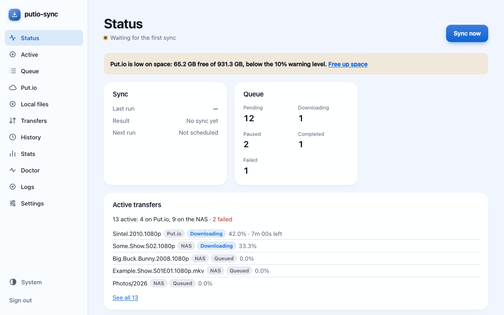

# putio-sync

[](https://github.com/devclinton/putio-sync/actions/workflows/ci.yml)
[](https://github.com/devclinton/putio-sync/releases/latest)
[](https://snapcraft.io/putio-sync)
[](https://github.com/devclinton/putio-sync/releases/latest)
[](https://github.com/devclinton/putio-sync/releases/latest)
[](LICENSE)

**Website and docs: [devclinton.github.io/putio-sync](https://devclinton.github.io/putio-sync/)**

<!-- ANCHOR: overview -->
**Keep a NAS or server in sync with your [Put.io](https://put.io) account.** putio-sync
downloads finished transfers to local storage, sends torrents and magnet links to
Put.io, and works as a download client for Radarr and Sonarr. It is one small Rust
binary with a web UI, built to run unattended on a home server: on a NAS it idles at
about 11 MB of memory.

putio-sync is an independent project and is not affiliated with Put.io.

## Highlights

- **Hands-off downloads.** New transfers land on your disk on their own, with parallel,
  resumable downloads, checksum verification and bandwidth schedules.
- **A web UI for everything.** Setup wizard, status, queue, Put.io browser, transfers,
  history, stats, logs and settings, on desktop or phone, light or dark, in 27 languages.
- **Radarr and Sonarr.** It speaks the Transmission protocol, so the *arr apps send
  releases to Put.io and get them back on local disk, with fake releases rejected first.
- **Watch folders.** Drop `.torrent` and `.magnet` files into a folder and they go to Put.io.
- **Per-folder rules.** Video, audio or ebook presets, blocked file types, skip folders,
  delete from Put.io after download.
- **Keeps Put.io tidy.** Empty-folder cleanup, storage warnings, and a Doctor page that
  finds stalled transfers, duplicates and leftovers, with one-click fixes.
- **Media extras.** An optional DLNA server for TVs and Kodi, subtitles from OpenSubtitles,
  and subtitle translation.
- **Observable and scriptable.** Prometheus metrics with a Grafana dashboard, event hooks,
  plugins, and a full CLI.

## Install

| Where | How |
|-------|-----|
| Docker / Compose | `ghcr.io/devclinton/putio-sync`; ready-made [compose.yaml](packaging/docker-compose/compose.yaml) |
| Unraid, Umbrel, CasaOS | Templates and app packages in [packaging/](packaging/STORES.md) |
| TrueNAS SCALE, Runtipi, Portainer, Dockge | Custom app from the same [compose.yaml](packaging/docker-compose/compose.yaml) |
| Linux (any distro) | `sudo snap install putio-sync` from the [Snap Store](https://snapcraft.io/putio-sync), see [snap/README.md](snap/README.md) |
| Debian / Ubuntu | `.deb` packages on [Releases](https://github.com/devclinton/putio-sync/releases/latest) |
| macOS | `brew install devclinton/putio-sync/putio-sync` ([tap](https://github.com/devclinton/homebrew-putio-sync)), or the `.pkg` installer on [Releases](https://github.com/devclinton/putio-sync/releases/latest) |
| Windows | `-setup.exe` installer (x64, arm64) on [Releases](https://github.com/devclinton/putio-sync/releases/latest) |
| Linux, macOS, Windows | Plain binaries on [Releases](https://github.com/devclinton/putio-sync/releases/latest) |
| From source | `cargo install --path putio-sync-cli` (Rust 1.96, pinned in `rust-toolchain.toml`) |

[INSTALLATION.md](INSTALLATION.md) has the details for each.

## Quick start

With Docker Compose:

```bash
mkdir putio-sync && cd putio-sync
curl -fsSLO https://raw.githubusercontent.com/devclinton/putio-sync/main/packaging/docker-compose/compose.yaml
docker compose up -d
docker compose logs putio-sync   # shows a one-time setup code
```

Open `http://<host>:15432/`, enter the setup code, and the wizard connects Put.io and
picks the download folder. The rest of this README is the full manual; what changed in
each build is in [CHANGELOG.md](CHANGELOG.md), and planned work is in [ROADMAP.md](ROADMAP.md).

<!-- ANCHOR_END: overview -->
## Contents

- [All features](#all-features) · [First run](#first-run) · [Commands](#commands) · [Configuration](#configuration)
- [Metrics](#metrics) · [Web UI](#web-ui) · [Media Server](#media-server) · [Tailscale](#tailscale)
- [Radarr and Sonarr](#radarr-and-sonarr) · [Release check](#release-check) · [Event hooks](#event-hooks) · [Plugins](#plugins)
- [Subtitles](#subtitles) · [Docker](#docker) · [Development](#development)

<!-- ANCHOR: all-features -->
## All features


- **Fast Downloads**: Concurrent downloads with configurable workers
- **Bandwidth Schedules**: download limits by time of day and day of week, plus Pause or Slow for an hour from the Status page ([details](#bandwidth-schedules))
- **Download Verification**: each download is checked against Put.io's CRC32 (or size) before it is finished, bad copies are downloaded again, and a "Verify everything" run checks files already on disk ([details](#download-verification))
- **Resumable Downloads**: Automatic resume for interrupted downloads using range requests
- **Streaming Downloads**: Efficient buffered streaming with minimal memory usage
- **Smart Progress Logging**: Size-based progress intervals with single-threshold logging (every 50% for 500MB+, 33% for 1GB+, 20% for 5GB+, 10% for 10GB+, 7% for 15GB+, 5% for 20GB+, 1% for 50GB+)
- **Empty Directory Cleanup**: Enhanced detection and tracking with 5-scan threshold for automatic deletion of empty folders
- **Put.io Empty-Folder Cleanup**: Remove empty folders from your Put.io account once a day or on demand, from the CLI, API or web UI ([details](#putio-empty-folder-cleanup))
- **Put.io Storage**: see what fills your Put.io account, get warned when free space runs low, and free space by deleting the oldest files already downloaded, with a preview first ([details](#putio-storage))
- **Smart Filtering**: Whitelist/blacklist patterns with glob support
- **Executable Guard**: Executables and installers on Put.io (`.exe`, `.msi`, `.bat`, ...) are never downloaded; configurable with `blocked_extensions`
- **Folder Rules**: Per-folder type presets (video, audio, ebooks, no binaries, or your own), skip a folder, or delete blocked files from Put.io; child folders inherit
- **Transfer Management**: Add torrents from files or magnet links
- **Radarr / Sonarr**: acts as their Transmission download client: Put.io transfer, local download, progress, completion and blocklisting of failed releases ([details](#radarr-and-sonarr))
- **Release check**: fake releases (an `.exe` posing as a movie, a locked `.7z`) are rejected before they reach Put.io or the NAS ([details](#release-check))
- **Watch Mode**: Automatically upload .torrent and .magnet files from watched directories with smart deduplication
- **Post-Processing**: Archive or delete processed torrent files after upload
- **Advanced Daemon**: Unified daemon with live log-level changes and graceful worker scaling
- **Prometheus Metrics**: Sync, download, watch-folder, API and database metrics on `:9742/metrics`
- **Media Server**: show downloaded files, and optionally a Put.io folder, to TVs, VLC and Kodi on your home network over DLNA / UPnP ([details](#media-server))
- **Web UI**: status, queue, Put.io browser, transfers, history, stats and settings in the browser on `:15432`, behind a token ([Web UI](#web-ui))
- **Statistics & History**: Track download stats and view history
- **File Management**: List, download, and delete files on Put.io
- **SQLite Database**: Local state tracking for downloads and history
- **Progress Tracking**: Multiple progress bar styles with speed and ETA

<!-- ANCHOR_END: all-features -->
<!-- ANCHOR: using-putio-sync -->
## Using putio-sync

### First run

Start the daemon (`putio-sync daemon`, the Docker image or the snap service)
before anything is configured and it waits in setup mode instead of exiting. It
prints a one-time setup code; open `http://<host>:15432/`, enter the code, and
the setup wizard walks through:

1. Connecting Put.io (the device link at put.io/link, or a pasted token).
2. The download folder, checked for write access and free space.
3. What to download, with the presets and top-level folder rules.
4. Optional extras: a watch folder, metrics, Radarr/Sonarr.
5. A dry run showing what the first sync would download.

Finishing writes the config once, creates an API token for the web UI (shown
once) and starts syncing. An API token that is already configured also unlocks
the wizard.

On a headless machine, run the same steps in a terminal:

```bash
putio-sync setup
# or without prompts:
PUTIO_SYNC_PUTIO_TOKEN=... putio-sync setup --download-dir /srv/putio --preset video --yes
```

A daemon in setup mode notices the new config within seconds. Exit codes: 0
written, 1 error, 2 cancelled.

#### Linking with a code (Put.io app ID)

The wizard and `putio-sync setup` can link to Put.io with a code you enter at
put.io/link instead of a pasted token, but only when they know a Put.io app ID.
Releases don't carry one yet, so until you set one both say the device link is
off and ask for a token (from put.io → Settings → API). To turn it on:

1. Sign in at put.io, open **API** from the account menu
   ([app.put.io/oauth](https://app.put.io/oauth)) and choose **Create App**.
   Any name, website and callback URL will do; the device link doesn't use
   the callback.
2. Enter the app's ID (a number) in the web wizard's **Connect Put.io** step
   or in **Settings › Put.io › Put.io**; either turns the device link on at once,
   without a restart. It is saved as `[putio] app_id`, so you can also put it
   in the config yourself. `PUTIO_SYNC_APP_ID` overrides the config, and
   Settings then shows the field as set by environment. A build can carry
   one with `PUTIO_SYNC_BUILTIN_APP_ID=<id> cargo build --release`, used
   when neither is set.

`putio-sync login` uses the same kind of app, with its ID, secret and callback
URL in `PUTIO_CLIENT_ID`, `PUTIO_CLIENT_SECRET` and `PUTIO_REDIRECT_URI`.

### Authentication

To authenticate with Put.io without the wizard:

```bash
putio-sync login
```

This will open your browser for OAuth authentication and save your token to `~/.putiosync/config.toml`.

Alternatively, you can manually set your token in the config file:

```bash
cp config.example.toml ~/.putiosync/config.toml
# Edit ~/.putiosync/config.toml and add your OAuth token
```

### Basic Usage

```bash
# List files in root folder
putio-sync list

# List files in a specific folder
putio-sync list --parent-id 123456

# Download all files
putio-sync download --all

# Download specific files
putio-sync download 123456 789012

# Download with filtering
putio-sync download --all --filter "*.mkv"

# Download with 4 workers and skip existing
putio-sync download --all --workers 4 --skip-existing

# Add torrent from magnet link
putio-sync create "magnet:?xt=urn:btih:..."

# Add torrent from file
putio-sync create movie.torrent

# Watch directory for torrents
putio-sync create --watch ~/Downloads/torrents

# View statistics
putio-sync stat

# View download history
putio-sync history --limit 20

# Delete files
putio-sync delete 123456 --yes
```

<!-- ANCHOR_END: using-putio-sync -->
<!-- ANCHOR: commands -->
## Commands

### `login`

Authenticate with Put.io using OAuth.

```bash
putio-sync login
```

Opens your browser for authentication and saves the token to your config file.

### `list`

List files and folders on Put.io.

```bash
putio-sync list [OPTIONS]

Options:
  -p, --parent-id <ID>      Parent folder ID (0 for root)
  -f, --filter <PATTERN>    Filter by filename pattern
  -o, --output <FORMAT>     Output format: table, json [default: table]
```

### `download`

Download files from Put.io with support for workers, filtering, and resuming.

```bash
putio-sync download [OPTIONS] [FILES]...

Arguments:
  [FILES]...                Specific file IDs to download

Options:
  -a, --all                 Download all files
  -f, --filter <PATTERN>    Filter by name pattern, as in folder rules (e.g., "*.mkv,*.mp4")
  -d, --dir <PATH>          Download directory [default: from config]
  -w, --workers <N>         Number of concurrent workers [default: from config]
  --buffer-size <SIZE>      Buffer size for streaming (e.g., 16MB) [default: from config]
  --no-resume               Start partial downloads over instead of resuming them
  --on-existing <CHOICE>    A file already on disk: resume, overwrite, keep-both [default: from config]
  --skip-existing           Same as --on-existing resume
  --delete-after            Delete from Put.io after download
  --sort <ORDER>            Sort order: by-date, by-name, by-extension, by-size
  --reverse                 Reverse sort order
  --progress <STYLE>        Progress style: per-file, overall, individual, rotating, none
  --daemon                  Run in daemon mode (periodic sync)
  --interval <SECONDS>      Daemon check interval [default: 300]
```

Examples:

```bash
# Download all files with 4 workers
putio-sync download --all --workers 4

# Download only video files
putio-sync download --all --filter "*.mkv,*.mp4"

# Download and delete from Put.io
putio-sync download --all --delete-after

# Download with custom buffer size for streaming
putio-sync download --all --buffer-size 32MB

# Run in daemon mode, checking every 5 minutes
putio-sync download --all --daemon --interval 300
```

### `delete`

Delete files from Put.io.

```bash
putio-sync delete [OPTIONS] [FILES]...

Arguments:
  [FILES]...                Specific file IDs to delete

Options:
  -a, --all                 Delete all files
  -f, --filter <PATTERN>    Filter files with glob pattern
  -r, --recursive           Delete folders recursively
  --before <DATE>           Delete files before date (e.g., "2026-01")
  --dry-run                 Show what would be deleted without deleting
  -y, --yes                 Skip confirmation prompt
```

Examples:

```bash
# Delete specific files
putio-sync delete 123456 789012

# Delete files matching pattern (with confirmation)
putio-sync delete --filter "*.txt"

# Delete all files before a date
putio-sync delete --all --before "2024-01-01" --yes

# Dry run to see what would be deleted
putio-sync delete --all --filter "*.log" --dry-run
```

### `files clean-empty`

Remove empty folders from your Put.io account. See
[Put.io Empty-Folder Cleanup](#putio-empty-folder-cleanup) for what counts as empty and
what is never removed.

```bash
putio-sync files clean-empty [OPTIONS]

Options:
  --dry-run                 List the folders that would be removed; delete nothing
  -y, --yes                 Skip the confirmation prompt
```

It prints each folder (id, path, age) and a summary line, and asks before deleting unless
`--yes`. It talks to Put.io directly, so the daemon need not be running. The exit code is
non-zero when the run fails or any delete fails.

### `files free-space`

Free Put.io space by deleting the oldest files already downloaded, until
`[storage] target_free_percent` is free. See [Put.io Storage](#putio-storage) for which
files are safe to delete.

```bash
putio-sync files free-space [OPTIONS]

Options:
  --dry-run                 List the files that would be deleted; delete nothing
  -y, --yes                 Skip the confirmation prompt
```

It prints each file (size, id, date added, Put.io path and local copy) and the totals,
then asks before deleting unless `--yes`. It needs the download database in the download
folder. The exit code is non-zero when any delete fails.

### `doctor`

Run the health checks and print a report. See [Doctor](#doctor) for what is checked.

```bash
putio-sync doctor [OPTIONS]

Options:
  --json                    Print the report (or the fix result) as JSON on stdout
  --fix <ID>                Preview and apply one fix, e.g. dead_queue_rows.remove
  --dry-run                 With --fix: show what it would act on; change nothing
  -y, --yes                 With --fix: skip the confirmation prompt
```

It needs no running daemon and never creates a database. Logs go to stderr, so `--json`
output is clean. Exit codes: 0 ok, 1 warning, 2 problem, 3 the doctor could not run. A
fix that deletes asks first, and with `--json` it needs `--yes` or `--dry-run`.

### `create`

Add torrents to Put.io from files or magnet links.

```bash
putio-sync create [OPTIONS] [SOURCES]...

Arguments:
  [SOURCES]...              Torrent files or magnet links to add

Options:
  -w, --watch <PATHS>...    Watch directories for .torrent and .magnet files
  --parent-id <ID>          Parent folder ID for downloads [default: 0]
  -d, --daemon              Run in daemon mode (continuous watching)
  --interval <SECONDS>      Watch check interval [default: 60]
```

Examples:

```bash
# Add torrent from magnet link
putio-sync create "magnet:?xt=urn:btih:..."

# Add torrent from file
putio-sync create movie.torrent

# Add magnet from .magnet file
putio-sync create movie.magnet

# Add multiple torrents and magnet files
putio-sync create file1.torrent file2.magnet file3.torrent

# Watch directory for torrents and magnet files
putio-sync create --watch ~/Downloads/torrents

# Watch multiple directories in daemon mode
putio-sync create --watch ~/Downloads --watch /media/torrents --daemon
```

### `stat`

View download statistics.

```bash
putio-sync stat [OPTIONS]

Options:
  --by-extension            Show breakdown by file extension
  --since <DATE>            Show stats since date (e.g., "2025-01-01")
  --until <DATE>            Show stats until date
  -o, --output <FORMAT>     Output format: table, json [default: table]
```

Examples:

```bash
# View overall statistics
putio-sync stat

# View statistics by file extension
putio-sync stat --by-extension

# View statistics for a date range
putio-sync stat --since "2025-01-01" --until "2025-12-31"
```

### `history`

View download and delete history.

```bash
putio-sync history [OPTIONS]

Options:
  --action <ACTION>         Filter by action: downloaded, deleted
  --since <DATE>            Show history since date
  --until <DATE>            Show history until date
  -n, --limit <N>           Limit number of results [default: 50]
  --offset <N>              Offset for pagination [default: 0]
  -o, --output <FORMAT>     Output format: table, json, csv [default: table]
```

Examples:

```bash
# View recent history
putio-sync history

# View only downloads
putio-sync history --action downloaded

# View history for a specific date range
putio-sync history --since "2025-01-01" --limit 100

# Export history to CSV
putio-sync history --output csv > history.csv
```

<!-- ANCHOR_END: commands -->
<!-- ANCHOR: configuration -->
## Configuration

Configuration is stored at `~/.putiosync/config.toml`. See `config.example.toml` for a complete example with all options documented.

### Path Handling

putio-sync supports flexible path formats for all directory configurations:

- **Absolute paths**: `/home/user/Downloads` (exact path)
- **Relative paths**: `./downloads`, `downloads` (relative to current directory)  
- **Home directory**: `~/Downloads` (expands to user home)
- **Current directory**: `.` (current working directory)

Examples:
```toml
[download]
target_directory = "~/Downloads/putio"      # Expands to /home/user/Downloads/putio
# target_directory = "/mnt/downloads"       # Absolute path
# target_directory = "./downloads"          # Relative to current directory

[watch] 
paths = [
    "~/Downloads/torrents",                 # Home relative
    "/var/watch/torrents",                  # Absolute path
    "./torrent-watch"                       # Current directory relative
]
```

### Download Configuration

Configure download behavior including streaming buffer size and resume support:

- **Streaming**: Files are downloaded using efficient buffered streaming
- **Buffer Size**: Configurable buffer for reading/writing (default: 16MB)
- **Resume Support**: Automatic resume using HTTP range requests for interrupted downloads
- **Recommended**: 16-32MB buffer size for optimal performance

```toml
[download]
buffer_size_mb = 16        # Stream buffer size for downloads
resume_enabled = true      # Enable automatic resume
on_existing = "resume"     # A file already on disk: resume, overwrite or keep_both
```

### When a file already exists

If a file is already at its local path and the download history does not list it as
done, `[download] on_existing` decides what happens:

| Choice | What is on disk | Result |
|---|---|---|
| `resume` (default) | Same size and CRC32 as on Put.io | Skipped, and recorded as downloaded |
| | Smaller | Continued from where it stops, then checked against Put.io's CRC32; a mismatch downloads it again from the start |
| | Larger, or same size with another CRC32 | Kept; the new file is saved as `name (1).ext` |
| `overwrite` | Anything | Downloaded again; the old file is replaced only once the new copy is complete |
| `keep_both` | A complete copy | Skipped |
| | Anything else | Kept; the new file is saved as `name (1).ext`, `name (2).ext`, … |

- Complete means the same size as on Put.io, and the same CRC32 when Put.io has one. The
  check reads the local file once; the Queue page shows "Checking" meanwhile.
- A folder at the file's path is never touched: the download fails with an error.
- A numbered name is kept on the queue row, so a restart resumes the same file.
- Radarr/Sonarr download-client items never get a numbered name, since those apps expect
  the file at its own path: they overwrite instead.
- `resume_enabled = false` (or `--no-resume`) starts partial files over instead of
  continuing them.
- `skip_existing` is replaced and still read: `true` is `resume`, `false` is `overwrite`. A
  save from the web UI writes `on_existing` and removes it.
- `--on-existing` sets it for one `download` or `daemon` run; folder rules can set it per
  folder.
- History shows the path a file was saved to when it differs, and a badge for resumed,
  restarted, overwritten and saved-as files; `putio_sync_existing_files_total` counts each
  outcome.

### Bandwidth schedules

`bandwidth_limit_bytes_per_sec` caps all downloads together, not each worker. A schedule
changes the cap by time of day and day of week; the first entry that contains the
current time wins, and outside every entry the default limit applies:

```toml
[download]
bandwidth_limit_bytes_per_sec = 5242880   # 5 MiB/s; leave out for unlimited
slow_limit_bytes_per_sec = 1048576        # used by "Slow 1 h" (default 1 MiB/s)

[[download.bandwidth_schedule]]
days = "daily"
start = "01:00"
end = "07:00"
limit = "unlimited"

[[download.bandwidth_schedule]]
days = "mon-fri"
start = "18:00"
end = "23:00"
limit = "paused"

[[download.bandwidth_schedule]]
days = "fri,sat"
start = "22:00"
end = "02:00"     # past midnight: Friday 22:00 to Saturday 02:00, and Saturday to Sunday
limit = 2097152   # 2 MiB/s
```

- `days`: `daily`, `weekdays`, `weekends`, a day (`mon` or `monday`), a range
  (`mon-fri`, `fri-mon`) or a comma list (`sat,sun`), in any case.
- `start` is `00:00` to `23:59` and `end` is `00:01` to `24:00`; an end before the start
  runs past midnight and belongs to the start day. `00:00` to `24:00` is a whole day.
- `limit` is `"unlimited"`, `"paused"` or bytes per second (above 0). At most 50 entries.

Times are the daemon's **local time**. In Docker set `TZ` (for example
`TZ=Europe/London`), otherwise it is UTC; the Status page and the doctor show the
daemon's time and UTC offset so you can check. Daylight-saving changes follow the
clock: a 01:00–07:00 entry is six hours most nights and five or seven on the change night.

A new limit, from the schedule or a save in Settings, applies to running downloads
within about a second. While paused, running downloads wait and nothing new starts.

The **Bandwidth** card on the Status page shows the limit in force, why (the default,
schedule entry N, or a pause), when it next changes, and the daemon's time. **Pause 1 h**
stops downloads and **Slow 1 h** drops to `slow_limit_bytes_per_sec` (or the schedule's
limit, if lower) for an hour; **Resume schedule** ends either early. These survive a
restart until they end. The API is `PUT /bandwidth/override` (`{"mode": "pause" | "slow",
"minutes": 60}`) and `DELETE /bandwidth/override`.

Mistakes are refused with the entry and field named, for example `download.bandwidth_schedule
entry 1: start '25:00': expected HH:MM between 00:00 and 23:59`. Overlapping entries, a
schedule that pauses the whole week, and limits under 64 KiB/s are allowed but warned
about in Settings and by the doctor. The one-off `download --bandwidth-limit` holds that
limit for the whole run and ignores the schedule.

### Download verification

Each download is checked against Put.io before it gets its real name. The CRC32 is
worked out while the file streams, so a new file is not read twice; a resumed file reads
back only the part already on disk. Where Put.io has no CRC32, the size is the check.

A file that does not match is downloaded again, up to `verify_max_redownloads` times;
then the download fails with reason `integrity`, the bad copy is deleted and nothing is
removed from Put.io, even with `delete_after_download`. `verify.passed` comes before
`download.finished`, so a media-server refresh only sees checked files.

```toml
[download]
verify = true                        # check each new download
verify_max_redownloads = 2           # 0 to 5; then the download fails
verify_read_limit_mb_per_sec = 50    # how fast a verify run reads from disk, 1 to 10000
verify_follow_bandwidth_pause = true # a run waits while the bandwidth schedule pauses
```

**Verify everything**, on the History page, checks files already downloaded: it reads
each one from disk at the read limit, compares it with Put.io, and queues a mismatch to be
downloaded over (or only reports it, with **Report only**). It can be paused, resumed and
stopped, waits while downloads are paused by the bandwidth schedule or **Pause 1 h**, and
skips a file being downloaded. Results are verified, mismatch, missing (gone from disk),
not on Put.io, busy, unreadable and not checked. On the Local files page, **Verify** checks
the ticked files, or everything under ticked folders.

History shows how each download was checked (CRC32, size or not checked) and how many
times it was downloaded again. The Queue and Active pages show **Verifying** while a
resumed file is read back. The doctor's **Download verification** check warns when
verification is off, a download failed its check in the last 7 days, or the last run
found mismatches that are still open.

### Basic Configuration

```toml
[auth]
auth_method = "Token"
token = "YOUR_OAUTH_TOKEN"

[download]
workers = 2
target_directory = "~/Downloads/putio"  # Supports ~, absolute, and relative paths
buffer_size_mb = 16                     # Stream buffer size for downloads
resume_enabled = true                   # Enable automatic resume
on_existing = "resume"                  # Skip complete files, continue partial ones
delete_after_download = true            # Clean up Put.io after successful downloads
progress_style = "per-file"             # Progress bar style
sort_order = "by-date"                  # File sorting order
max_retries = 3                         # Retry failed downloads
bandwidth_limit_bytes_per_sec = 1048576 # Optional: 1 MB/s limit

[watch]
refresh_cycle = 60
paths = []
```

### Environment Variables

- `PUTIO_SYNC_CONFIG`: Custom config file path
- `RUST_LOG`: Log level (error, warn, info, debug, trace). When set, it replaces
  `[logging] level` from the config file. The startup line `Log level level=... source=Env`
  (or `source=Config`) shows which one is in effect.
- `PUTIO_SYNC_API_TOKEN`, `PUTIO_SYNC_API_LISTEN`, `PUTIO_SYNC_API_BIND`: web UI and API
  listener, see [Web UI](#web-ui).

<!-- ANCHOR_END: configuration -->
<!-- ANCHOR: metrics -->
## Metrics

Both `daemon` and `server` modes serve Prometheus metrics at
`http://0.0.0.0:9742/metrics` by default, in the text exposition format. The listener
starts even when no Put.io token is set. If the port can't be bound, one error is logged
and putio-sync keeps running without metrics.

```toml
[metrics]
enabled = true          # PUTIO_SYNC_METRICS_ENABLED
bind = "0.0.0.0:9742"   # PUTIO_SYNC_METRICS_BIND
path = "/metrics"       # PUTIO_SYNC_METRICS_PATH
detail = "basic"        # PUTIO_SYNC_METRICS_DETAIL: basic | detailed
```

> **No auth.** Anything that can reach the port can read the metrics. They never contain
> tokens, file names, ids, paths or URLs, but keep the port on a trusted network.

`detailed` adds per-operation API latency and per-worker series. Counters reset when the
process restarts, so query them with `increase()` or `rate()`. In Docker, publish the
port (`-p 9742:9742`).

### Verbosity

Logging and metrics detail are set in `config.toml` or by environment variables; the
variable wins when both are set.

| Variable | Setting | Allowed | Applies |
|---|---|---|---|
| `RUST_LOG` | `logging.level` + `module_filters` | any tracing `EnvFilter` directive | restart; while set, config level changes are ignored |
| `PUTIO_SYNC_LOG_FORMAT` | `logging.console_format` | `compact`, `pretty`, `json` | restart |
| `PUTIO_SYNC_METRICS_ENABLED` | `metrics.enabled` | `true`, `false`, `1`, `0` | restart |
| `PUTIO_SYNC_METRICS_BIND` | `metrics.bind` | `host:port` | restart |
| `PUTIO_SYNC_METRICS_PATH` | `metrics.path` | starts with `/` | restart |
| `PUTIO_SYNC_METRICS_DETAIL` | `metrics.detail` | `basic`, `detailed` | restart |

`logging.level` and `logging.module_filters` in the config file are live: putio-sync checks
the file every 10 s and logs `Log level changed old=info new=debug source=Config`. An invalid
level logs `Log level not changed` once and keeps the current one. An invalid value at
startup, in the file or the environment, stops putio-sync with
`invalid <setting> '<value>': expected one of <allowed>`.

The effective settings are logged at startup:

```text
Log level level=info source=Config format=compact format_source=Config
Metrics enabled bind=0.0.0.0:9742 path=/metrics detail=basic source=Config
```

### Metric families

H = histogram.

| Name | Type | Labels | Meaning |
|---|---|---|---|
| `putio_sync_api_requests_total` | counter | `operation`, `outcome` | Each HTTP attempt to Put.io, retries included |
| `putio_sync_api_retries_total` | counter | `reason` | Each retry scheduled by the retry policy |
| `putio_sync_api_request_duration_seconds` | H | — | Latency of each attempt |
| `putio_sync_api_operation_duration_seconds` | H | `operation` | **detailed only.** Latency per operation |
| `putio_sync_sync_runs_total` | counter | `result` | Completed sync runs |
| `putio_sync_sync_duration_seconds` | H | — | Duration of each sync run |
| `putio_sync_last_sync_duration_seconds` | gauge | — | Duration of the latest run |
| `putio_sync_last_success_timestamp_seconds` | gauge | — | Unix time the last successful run finished; absent until the first one |
| `putio_sync_last_sync_files` | gauge | `kind` | Counts from the latest run |
| `putio_sync_files_blocked_total` | counter | — | Files blocked or skipped by a folder rule or the blocked-extension list (once per file id) |
| `putio_sync_rule_decisions_total` | counter | `decision` | Folder rule decisions: `blocked`, `skipped`, `deleted` (from Put.io) |
| `putio_sync_sync_in_progress` | gauge | — | 1 while a sync run is in progress, else 0 |
| `putio_sync_queue_items` | gauge | `state` | Queue rows by state, refreshed every 15 s and at startup |
| `putio_sync_downloads_active` | gauge | — | Downloads in progress |
| `putio_sync_download_workers` | gauge | — | Configured worker count |
| `putio_sync_download_bandwidth_limit_bytes_per_second` | gauge | — | The download limit in force: `+Inf` unlimited, 0 paused |
| `putio_sync_download_bandwidth_override` | gauge | — | 1 while **Pause 1 h** or **Slow 1 h** is in force, else 0 |
| `putio_sync_verify_total` | counter | `trigger`, `method`, `result` | Download checks: `trigger` is `download` or `run`, `method` is `crc32`, `size` or `none`, `result` is `passed` or `failed` |
| `putio_sync_verify_redownloads_total` | counter | `trigger` | Files downloaded again (or queued to be) after a mismatch |
| `putio_sync_verify_run_files_total` | counter | `result` | Files a verify run classed: `verified`, `mismatch`, `missing`, `not_on_putio`, `busy`, `unreadable`, `not_checked` |
| `putio_sync_verify_read_bytes_total` | counter | — | Bytes read back from disk to check files |
| `putio_sync_verify_run_active` | gauge | — | 1 while a verify run is going, else 0 |
| `putio_sync_downloads_completed_total` | counter | — | Downloads verified and renamed into place |
| `putio_sync_downloads_failed_total` | counter | `reason` | Downloads that ended in failure |
| `putio_sync_downloaded_bytes_total` | counter | — | Bytes written to disk; `rate()` gives throughput |
| `putio_sync_download_duration_seconds` | H | — | Time per completed download |
| `putio_sync_existing_files_total` | counter | `outcome` | A file already at its path: `skipped`, `resumed`, `restarted`, `overwritten`, `saved_as`, `refused` |
| `putio_sync_worker_state` | gauge | `worker` | **detailed only.** 0 idle, 1 downloading |
| `putio_sync_worker_inflight_bytes` | gauge | `worker` | **detailed only.** Bytes written so far for the current file |
| `putio_sync_watch_scans_total` | counter | — | Watch-folder scans |
| `putio_sync_watch_uploads_total` | counter | — | Torrent/magnet files uploaded to Put.io |
| `putio_sync_watch_cleanups_total` | counter | — | Already-uploaded files cleaned up |
| `putio_sync_watch_invalid_total` | counter | — | Invalid files (warned once) |
| `putio_sync_watch_cleanup_failures_total` | counter | — | Cleanup (delete/archive) failures |
| `putio_sync_empty_folder_runs_total` | counter | `trigger`, `result` | Finished Put.io empty-folder cleanup runs; dry runs not counted |
| `putio_sync_empty_folders_deleted_total` | counter | — | Empty folders removed from Put.io, nested ones included |
| `putio_sync_empty_folder_delete_failures_total` | counter | — | Empty-folder deletes that failed |
| `putio_sync_empty_folder_last_success_timestamp_seconds` | gauge | — | Unix time of the last successful cleanup run; absent until the first |
| `putio_sync_putio_storage_size_bytes` | gauge | — | Put.io account storage size |
| `putio_sync_putio_storage_used_bytes` | gauge | — | Put.io account storage in use |
| `putio_sync_storage_free_runs_total` | counter | `trigger`, `result` | Finished Put.io free-up runs; previews not counted |
| `putio_sync_storage_freed_files_total` | counter | — | Files deleted from Put.io to free space |
| `putio_sync_storage_freed_bytes_total` | counter | — | Bytes deleted from Put.io to free space |
| `putio_sync_tailscale_identity_total` | counter | `via` (serve, whois), `result` (allowed, refused) | Requests that claimed a Tailscale identity (feature 036) |
| `putio_sync_db_errors_total` | counter | `operation` | Database errors |
| `putio_sync_disk_free_bytes` | gauge | — | Free space for the download folder; absent if unreadable |
| `putio_sync_disk_total_bytes` | gauge | — | Size of the download folder's filesystem; absent if unreadable |
| `putio_sync_transfers_stalled` | gauge | — | Put.io transfers with no new bytes for `[transfers] stall_threshold_hours` (`daemon` only) |
| `putio_sync_pipeline_items` | gauge | `stage` (putio, nas), `state` | Items on the Active page by stage and state (`daemon` only) |
| `putio_sync_pipeline_actions_total` | counter | `action` (pause, hold, resume) | Pause and resume actions on Active items |
| `putio_sync_subtitles_saved_total` | counter | `source` (putio_embedded, putio_folder, opensubtitles, os_hash, os_ids, os_name, transcribed), `language` | Subtitles saved next to videos |
| `putio_sync_subtitles_skipped_total` | counter | `reason` (below_threshold, quota, no_result, no_ids, no_name, not_configured) | Wanted subtitles that OpenSubtitles did not fill |
| `putio_sync_opensubtitles_requests_total` | counter | `endpoint` (search, download, login), `result` (ok, rate_limited, quota, error) | Calls to the OpenSubtitles API |
| `putio_sync_subtitles_transcribed_seconds_total` | counter | — | Seconds of audio sent to the transcription server |
| `putio_sync_nas_downloads_paused` | gauge | — | 1 while the Pause NAS downloads switch is on, else 0 |
| `putio_sync_doctor_check_status` | gauge | `check` | Doctor check result: 0 ok, 1 warning, 2 problem, -1 skipped (`daemon` only) |
| `putio_sync_doctor_check_items` | gauge | `check` | Items the check found at its last run |
| `putio_sync_doctor_last_run_timestamp_seconds` | gauge | — | Unix time the last doctor run finished; absent until the first |
| `putio_sync_doctor_last_run_duration_seconds` | gauge | — | Duration of the last doctor run |
| `putio_sync_arr_rpc_requests_total` | counter | `method`, `outcome` | Transmission RPC requests from Radarr/Sonarr; `outcome` is `ok`, `error` or `auth_failed` |
| `putio_sync_arr_items` | gauge | `state` | Radarr/Sonarr items by state: `putio`, `local`, `done`, `failed` |
| `putio_sync_arr_blocklist_total` | counter | `outcome` | Calls asking Radarr/Sonarr to blocklist a failed release: `ok`, `not_found`, `error` |
| `putio_sync_arr_path_mapping_total` | counter | `result` | Remote Path Mappings changed by setup: `created`, `updated`, `removed`, `failed` |
| `putio_sync_precheck_total` | counter | `source`, `stage`, `outcome` | Release checks: `source` is `torrent`, `url`, `magnet`, `watch_torrent`, `watch_magnet`; `stage` is `before` (Put.io) or `putio`; `outcome` is `passed`, `rejected`, `unknown` |
| `putio_sync_precheck_avoided_bytes_total` | counter | `stage` | Bytes in the file lists of rejected releases |
| `putio_sync_precheck_cache_lookups_total` | counter | `cache`, `result` | Magnet cache requests by cache host: `found`, `not_found`, `timeout`, `wrong_hash`, `error` |
| `putio_sync_precheck_cache_lookup_seconds` | H | — | Time to look one magnet up across the caches |
| `putio_sync_precheck_fallback_total` | counter | `result` | Magnets sent to Put.io unchecked, by how the check there went: `passed`, `rejected` |
| `putio_sync_precheck_fallback_putio_bytes_total` | counter | — | Bytes Put.io fetched for unchecked magnets that were then rejected |
| `putio_sync_release_flags_total` | counter | `kind` | Operator flags: `fake`, `not_fake` |
| `putio_sync_events_total` | counter | `type` | Events put on the internal event bus |
| `putio_sync_hook_runs_total` | counter | `hook`, `event`, `result` | Hook runs: `success`, `failure`, `timeout` |
| `putio_sync_hook_run_duration_seconds` | H | `hook` | Duration of each hook run, retries included |
| `putio_sync_hook_events_dropped_total` | counter | `hook` | Events dropped because the hook's queue was full |
| `putio_sync_plugin_runs_total` | counter | `plugin`, `event`, `result` | Plugin calls (an event type, `tick`, `init`, `action` or `health`): `success`, `failure`, `timeout` |
| `putio_sync_plugin_run_duration_seconds` | H | `plugin` | Duration of each plugin call |
| `putio_sync_plugin_events_dropped_total` | counter | `plugin` | Events dropped because the plugin's queue was full |
| `putio_sync_plugin_counter_total` | counter | `plugin`, `name` | A plugin's own counts, such as the media plugins' `refreshes`, `folders_grouped`, `skipped` and `refresh_failures` |
| `putio_sync_log_lines_dropped_total` | counter | `reason` | Log lines the Logs page never showed: `evicted` (pushed out of memory), `lagged` (a live view fell behind) |
| `putio_sync_start_time_seconds` | gauge | — | Process start, Unix seconds |
| `putio_sync_build_info` | gauge (=1) | `version`, `commit` | Build identity |
| `putio_sync_process_cpu_seconds_total` | counter | — | CPU time used (user + system); `rate()` gives cores in use |
| `putio_sync_process_resident_memory_bytes` | gauge | — | Memory in use (RSS) |
| `putio_sync_process_virtual_memory_bytes` | gauge | — | Memory reserved (virtual size) |
| `putio_sync_process_threads` | gauge | — | OS threads |
| `putio_sync_process_open_fds` | gauge | — | Open files and sockets |
| `putio_sync_process_max_fds` | gauge | — | Soft open-file limit; absent when unlimited |
| `putio_sync_process_disk_read_bytes_total` | counter | — | Bytes read from storage |
| `putio_sync_process_disk_written_bytes_total` | counter | — | Bytes written to storage |

The `putio_sync_process_*` figures are read from `/proc` at each scrape, so they exist on
Linux only (including the Docker image). Elsewhere they are absent, and putio-sync logs one
warning, `Process metrics unavailable`, at the first scrape. A figure the kernel hides, such
as disk I/O in some containers, is left out on its own.

Label values are fixed sets, listed in
[specs/003-telemetry-prometheus/data-model.md](specs/003-telemetry-prometheus/data-model.md#closed-label-sets).

### Useful queries

| Question | Query |
|---|---|
| Syncs failed last week | `increase(putio_sync_sync_runs_total{result="failure"}[7d])` |
| Retries and why | `sum by (reason) (increase(putio_sync_api_retries_total[1d]))` |
| Pending and moving? | `putio_sync_queue_items{state="pending"}` and `increase(putio_sync_downloads_completed_total[1h])` |
| Executables blocked | `increase(putio_sync_files_blocked_total[7d])` |
| Watch cleanups | `increase(putio_sync_watch_cleanups_total[7d])` |
| DB errors | `increase(putio_sync_db_errors_total[1d])` |
| Transfers stuck | `putio_sync_transfers_stalled > 0` |
| Doctor problems | `putio_sync_doctor_check_status == 2` |
| Fakes rejected this week | `sum(increase(putio_sync_precheck_total{outcome="rejected"}[7d]))` |
| Caches failing | `sum by (cache, result) (increase(putio_sync_precheck_cache_lookups_total{result!="found"}[1d]))` |
| CPU in use (cores) | `rate(putio_sync_process_cpu_seconds_total[5m])` |
| Memory in use | `putio_sync_process_resident_memory_bytes` |

### Grafana dashboard

[`packaging/grafana/putio-sync-resources.json`](packaging/grafana/putio-sync-resources.json)
is a `putio-sync resources` dashboard: CPU, memory in use and reserved, threads, open
files against the limit, disk read and write, and uptime, with restarts and new builds
marked, next to downloads and syncs. Import it in Grafana (Dashboards → New → Import)
and pick your Prometheus data source. Every query filters on `app="putio-sync"` and a
`host` variable, so give the scrape job those labels:

```yaml
- job_name: putio_sync
  static_configs:
    - targets: ["<nas>:9742"]
      labels: {app: "putio-sync", host: "<nas>"}
```

The "Use by activity" row and the per-MB/s panel read 5-minute recording rules
(`putio_sync:*:*5m`, feature 041) and stay empty without them; the other panels need
only the raw scrape.

### Long-term archive

Prometheus keeps what it scrapes for a limited time. `putio-sync archive` keeps the
5-minute resource series, a copy of the download database and a usage summary in a folder
you control, so a year of CPU, memory and download history survives. It is a one-shot
command: run it from cron or the Unraid User Scripts plugin; the daemon does not need to
stop.

```bash
putio-sync archive metrics --prometheus http://192.168.1.60:9090   # one file per finished UTC day
putio-sync archive db                                              # a copy of .putiosync.db
putio-sync archive summary --prometheus http://192.168.1.60:9090   # CSV and text usage report
```

| Command | Saves | Where (under the archive folder) |
|---|---|---|
| `metrics` | the `putio_sync:*:*5m` recording rules of each finished UTC day not yet saved, as gzipped OpenMetrics (288 points a day; short days are marked `partial`; days without data are retried next run) | `metrics/putio-sync-metrics-<day>.om.gz` |
| `db` | a consistent snapshot of the database (`VACUUM INTO`, safe while the daemon runs), once per day | `db/putio-sync-db-<day>.sqlite.gz` |
| `summary` | downloads, bytes, speed, and, with `--prometheus`, CPU and memory by activity per day and month | `summary/usage-daily.csv`, `usage-monthly.csv`, `usage-latest-month.txt` |

The folder is `--dir` or `PUTIO_SYNC_ARCHIVE_DIR`, by default `archive` next to the config
file (`/config/archive` in Docker). `--prometheus` can also be set with
`PUTIO_SYNC_ARCHIVE_PROMETHEUS_URL`; `--instance` (`PUTIO_SYNC_ARCHIVE_INSTANCE`) picks the
scrape target when Prometheus has more than one `app="putio-sync"` instance.
`--keep-days N` (`PUTIO_SYNC_ARCHIVE_KEEP_DAYS`) deletes archive files older than N days;
without it nothing is deleted, and only files the command wrote are ever removed.
`--require-manifest` refuses to run when the folder has no `manifest.jsonl`, which stops a
share that failed to mount from silently filling the wrong disk. Files are written to a
temp name and renamed, so a crash leaves no half-written archive. No token is read or
printed. Exit codes: 0 done, 1 bad arguments or config, 2 Prometheus, 3 database, 4
archive folder.

**Unraid.** Install the User Scripts plugin, add a script with the contents of
[`scripts/archive/unraid-user-script.sh`](scripts/archive/unraid-user-script.sh) (set `P`
to your Prometheus address) and schedule it as Custom `30 3 * * *`. It saves metrics and the
summary daily and the database on Mondays. Run the three commands once by hand first (the
script passes `--require-manifest`, which needs the first run to have created the folder
and manifest).

**Restore** a day into a Prometheus you run yourself with promtool:

```bash
gunzip -k metrics/putio-sync-metrics-2026-11-01.om.gz
promtool tsdb create-blocks-from openmetrics metrics/putio-sync-metrics-2026-11-01.om ./data
# move the blocks into Prometheus's data directory and restart it
```

To restore the database, `gunzip` the `db/` file and use it as `.putiosync.db` with the
daemon stopped.

<!-- ANCHOR_END: metrics -->
<!-- ANCHOR: web-ui -->
## Web UI

`daemon` serves a browser UI and the JSON API on one port, by default
`http://<nas>:15432/` (for example `http://192.168.1.50:15432/`). It works on a phone
as well as a desktop.



The pages:

- **Status**: version, uptime, last and next sync, queue counts, active downloads,
  workers, watch folders, disk space and Put.io reachability. **Sync now** starts a
  folder sync at once; a second click while one runs says it is already in progress.
- **Active**: every transfer on its way to the NAS, once each, in its Put.io or NAS stage,
  with pause, resume and a Recently finished list ([details](#active-transfers)).
- **Queue**: pause, resume, skip, reorder (up, down, first, last), clear completed,
  cancel a running download. Higher priority downloads first; a move renumbers the
  whole queue. The **Pause NAS downloads** switch stops all NAS downloads at once.
- **Put.io**: browse folders, filter by name, queue a file or a whole folder
  ("found, queued, skipped, blocked"), delete from Put.io with confirmation. Delete is
  refused for files that are queued, downloading or paused. Tick rows (or **Select
  all**) to download or delete several at once, with one confirmation for the lot;
  queued files can't be ticked.
- **Transfers**: add a magnet link, URL or `.torrent` file; retry a failed transfer;
  remove a transfer (Put.io cancels it). Put.io has no pause or resume for transfers.
  A transfer still downloading with no new bytes for 6 hours gets a **stalled** badge
  and the likely reason (availability below 100%, no peers, or no progress); see
  [Stalled transfers](#stalled-transfers). **Copy magnet** copies its magnet link,
  and **Re-add** cancels it and adds the same magnet again to the same folder.
  Tick rows (or **Select all**) to retry or remove several at once. **Clear
  completed** (completed and seeding), **Clear failed** and **Clear all finished**
  remove those transfers from the Put.io transfer list after a confirm with the count;
  their files stay in the account.
- **History**: downloads and deletions, filtered by action and by name, with how each
  download was verified; the Verification panel runs **Verify everything**.
- **Stats**: charts of what was downloaded and when (see [Stats page](#stats-page)).
- **Doctor**: the latest health report with **Run now** and one-click fixes; a fix that
  deletes lists what it will touch and asks first (see [Doctor](#doctor)).
- **Settings**: download, watcher, logging and notification settings (see
  [Settings from the UI](#settings-from-the-ui)). The API token and Put.io
  credentials are never shown.

The UI is built into the binary and the Docker image; there is nothing else to install
or mount.

### Languages

The UI follows the browser's language when it has a translation, and English otherwise.
**Settings › General › Language** picks another one for this browser and switches at once.
Translations are machine-made for Arabic, Chinese (simplified and traditional), Danish, Dutch,
Finnish, French, German, Hebrew, Hindi, Indonesian, Italian, Japanese, Korean, Malay,
Norwegian Bokmål, Polish, Portuguese (Brazil and Portugal), Russian, Spanish, Swedish, Thai,
Turkish, Ukrainian and Vietnamese. Names, paths, log lines and messages from the daemon stay as
they are.

The catalogs are `putio-sync-api/ui/i18n/<code>.json`, each mapping the English text to its
translation, so a correction is an edit to one line. After changing UI text, `make i18n`
refreshes `en.json` (`make ci` fails until it is current) and `make i18n-translate` fills the
new strings in every catalog through `atranslate-cli` (set `ATRANSLATE_URL` to the service).

### Stats page

`#/stats` shows, for the last 24 hours, 7, 30 or 90 days, a year or everything:

- totals: files, bytes, time spent downloading and average speed;
- **Bandwidth**: bytes per hour, six hours, day or week, spread over each download's
  duration; hover, tap or use the arrow keys for a bar's details;
- **When**: an hour × weekday heatmap in your local time, by bytes or by files;
- **File types**: video, audio, archive, image, document, subtitle and other, with the
  top extensions in each;
- **Origin**: how each download reached Put.io (a watch folder, added in putio-sync,
  added on Put.io) and its top-level Put.io folder;
- **Sources**: torrent, URL or other; the tracker host; private or public.

Filters for type, source, tracker, privacy, origin, watch folder and Put.io folder sit
above the charts, and clicking a row in a breakdown sets that filter. Filters are kept
in the page address, so a reload or a bookmark keeps them.

The numbers come from putio-sync's own download history, not from Prometheus. Sources
and origins are recorded when a file is queued, starting with this version; older
downloads show as "unknown". Only the tracker's host name is stored, never the tracker
URL or its passkey. Put.io doesn't report DHT peers, so there is no DHT breakdown;
private torrents don't use DHT anyway. The page reads `GET /stats/summary` (token
required), which takes the same filters as query parameters.

### Token (required)

> **Breaking change.** The API no longer has an open mode. Without a token every request
> except `/health` is refused with 401 `API token not configured`, and the UI shows a
> "set a token and restart" notice instead of the sign-in form.

Set a token in `config.toml` or, preferably, in the environment:

```toml
[api]
auth_token = "a-long-random-string"   # or PUTIO_SYNC_API_TOKEN
```

The token must be non-empty and contain no whitespace; `auth_token = ""` stops
putio-sync at startup. Sign in with it once per browser; the browser keeps it until
you sign out. API clients send
`Authorization: Bearer <token>`. The token is never logged or returned; startup logs
only `token=set` or `token=unset`.

Five wrong tokens from one IP within 60 s lock that IP out until 60 s after its first
failure: further requests get 429 with `Retry-After`, even with the right token. Requests with
no token at all are refused but not counted.

> **Plain HTTP.** The UI and API have no TLS. The token crosses the network in clear
> text, so keep the port on a trusted LAN and don't forward it to the internet.

### Settings

| Variable | Setting | Allowed | Default |
|---|---|---|---|
| `PUTIO_SYNC_API_TOKEN` | `api.auth_token` | non-empty, no whitespace | unset (everything refused) |
| `PUTIO_SYNC_API_LISTEN` | `api.listen` | `true`, `false`, `1`, `0` | `true` |
| `PUTIO_SYNC_API_BIND` | `api.bind` | comma-separated addresses (see below) | `0.0.0.0:15432` |

The variable wins over `config.toml`. All three need a restart. `listen` is read by
`daemon` only; `bind` by both `daemon` and `server` (see [Listen addresses](#listen-addresses)).
Set `PUTIO_SYNC_API_LISTEN=0` to turn the listener off. If an address can't be bound,
the daemon logs one `API listener failed to start` error, keeps syncing and tries again. With `[api] enabled = true`
(downloads delegated to a remote API server) the daemon doesn't start its own listener.

Startup lines:

```text
API listener enabled bind=0.0.0.0:15432 token=set source=Config
API token not configured (set [api] auth_token or PUTIO_SYNC_API_TOKEN); all API and UI requests will be refused
```

In Docker, publish the port: `-p 15432:15432`, or add a port mapping for container
port 15432 in the Unraid template.

### Listen addresses

`[api] bind` and `[metrics] bind` take one address or a list:

```toml
[api]
bind = ["127.0.0.1:15432", "eth0:15432", "[::1]:15432", "tailnet:15432"]
```

| Entry | Listens on |
|---|---|
| `0.0.0.0:15432`, `192.168.1.10:15432` | that IPv4 address (`0.0.0.0` = all IPv4 addresses) |
| `[::]:15432`, `[::1]:15432` | that IPv6 address |
| `eth0:15432`, `tailscale0:15432` | every address the interface has, followed as it changes (DHCP, VPN up or down) |
| `tailnet:15432` | this machine's Tailscale IPv4 address, once Tailscale gives one |

An entry with no address now (the interface is down, Tailscale is signed out) waits and
is checked again (every second for 5 minutes, then every 30 seconds); putio-sync never falls back to all
addresses. `PUTIO_SYNC_API_BIND` and `PUTIO_SYNC_METRICS_BIND` take a comma-separated
list. `GET /listen` and Settings › Network and access › Network show each entry and what it listens on now,
and the doctor's "Listening addresses" check warns about an entry with no address.

`server` listens on the same list (tailnet-only included) when no flag is given:

| `server` flags | Listens on |
|---|---|
| none | `[api] bind` (or `tailnet:<port>` with tailnet-only) |
| `--bind H` | `H` with the first configured port; `H` is an IP, an interface or `tailnet` |
| `--bind H --port P` | `H:P` |
| `--port P` | every configured entry, on port `P` |
| `--bind H:P2 --port P` | an error: give the port once |

The Tailscale card and the Radarr/Sonarr host report the port actually listened on.

**Loopback behind a reverse proxy.** With the API on loopback only (`127.0.0.1:15432`)
behind a local reverse proxy (nginx, Caddy), every request arrives from loopback. Keep
`[tailscale] identity_sign_in` off then: putio-sync trusts `tailscale serve`'s identity
headers on a loopback connection, and a proxy could pass them on. The doctor and the
Network settings warn about this combination.

### Settings from the UI

Settings has eight sections: General, Put.io, Downloads, Rules and filters, Integrations,
Plugins, Network and access, and Advanced; the docs name a card as "Settings › Section › Card".
Each section has its own address, `#/settings/<section>`, and `?field=download.verify`
(a config key) opens it at that setting. The search box finds a setting by its label or
help. A section shows *unsaved* while a card in it has unsaved changes, and a count of
its problems (a warning about one of its settings, a card that failed to load, a refused
save); the browser asks before closing the tab with unsaved changes. Rarely changed
fields (buffer and chunk sizes, retry delays, scan intervals and the like) are hidden
until **Show advanced** is on for that section; the choice is kept in this browser.

A save edits only the settings that changed in `config.toml`; comments, blank lines,
ordering and keys it doesn't know stay as they are. The credentials are never written:
`[auth]` and `api.auth_token` stay as they are in the file, so a token set only through
`PUTIO_SYNC_API_TOKEN` never reaches it. The file is replaced atomically and keeps its
mode; a file that doesn't parse is left alone and the save fails. The response
names each changed setting as applying now or needing a restart; the UI shows it as is,
and a save that changed nothing says so. Under `daemon`, the UI and API share the
daemon's download manager and watcher:

| Group | Applies live | Needs a restart |
|---|---|---|
| Logging | `level`, `module_filters`, within 10 s (ignored while `RUST_LOG` is set) | `console_format`, `console_enabled`, `file_*` |
| Download | `workers` (the pool scales), `bandwidth_limit_bytes_per_sec`, `bandwidth_schedule`, `slow_limit_bytes_per_sec` (running downloads too), `buffer_size_mb`, `max_retries`, `retry_initial_delay_secs`, `on_existing`, `resume_enabled`, `delete_after_download`, `blocked_extensions`, `verify`, `verify_max_redownloads`, `verify_read_limit_mb_per_sec`, `verify_follow_bandwidth_pause`, for the next download or verify run | `target_directory` (new downloads go there at once, but the queue database and disk figures stay on the startup folder), and the rest of the group |
| Watcher | `paths`, `parent_folder_id`, `archive_directory`, at the next scan, if the daemon started with at least one watch folder | `enabled` (also the watcher Start/Stop endpoints, which only save the flag), `delete_after_upload`; with no watch folder at startup, everything. `refresh_cycle` is unused: the daemon scans on `--watch-interval` |
| Cleanup | `enabled`, `run_at`, `min_age_hours`, `nested`, from the next run or schedule check | — |
| Release check | — | everything |
| Notifications | — | everything |
| Network | — | everything (`api_bind`, `metrics_bind`); the UI asks first when the new list wouldn't reach the page you're on |
| Event hooks | everything, at once | — |
| Plugins | everything, at once (a new `plugins_dir` is read on save) | — |

Under `server`, the logging rows are the same (when the config file existed at
startup). Download changes reach only the API's own download manager, not the
`--download` background thread, and watcher and notification changes need a restart.
The daily cleanup runs only under `daemon`; under `server`, `min_age_hours` and `nested`
apply to manual runs.

Invalid values are refused with 400 and a JSON `error`, and nothing is saved. A
watch folder must exist before the watcher can be enabled.

### Configuration assistant

Each settings card helps before you save:

- **Preview.** As you edit, the card lists what Save would change, old and new value,
  each marked *applies now* or *needs a restart* for the engine you run (the table
  above), or the reason Save would refuse it. A preview never writes the file.
- **What it affects.** Each field has an *Affects* line saying what it changes.
- **Warnings.** Risky combinations show in the preview, in a banner at the top of
  Settings and in the doctor's *Config file* check:

  | Warning | When |
  |---|---|
  | Danger: only copy in a temporary folder | `delete_after_download` with the download folder in `/tmp`, `/var/tmp` or the system temp folder |
  | Danger: only copy in the container | `delete_after_download` in a container, with the download folder on the container's own disk rather than a mounted volume |
  | Watch folder in the download folder | the watcher on, with a watch folder inside the download folder |
  | Archive in a watch folder | the watcher on, with its archive folder inside a watch folder |
  | Cleanup without a minimum age | the daily cleanup with `min_age_hours = 0` |
  | Many workers | more than 10 download workers |
  | Verbose log file | the log file on with level `trace` or `debug` |

- **Defaults.** The Defaults button fills the card with the default values, keeping
  the download folder; nothing is saved until Save.
- **Backup and restore.** Export downloads `putio-sync-settings.toml` with every
  setting except `[auth]`, `api.auth_token` and `[arr]`. Import (a file or pasted
  text) merges the file over the current settings: keys it leaves out keep their
  value, credentials and `[arr]` in it are ignored and listed, unknown keys are
  listed, and you see the changes before Apply. Apply saves the same way as a card,
  so comments and the file's credentials stay.

### Logs page

`#/logs` shows the most recent log lines the daemon kept in memory: 2,000 by default,
set with `[logging] buffer_lines` (100 to 50,000) or **Settings › Advanced › Logging › Lines kept for
the Logs page**, which applies at once. Only lines the level in effect lets through are
kept, so debug and trace lines appear only while turned on.

- Filter by level (that level and above), module (`putio_sync_download`, a prefix
  matches its submodules) and text. Filters are kept in the page address.
- New lines arrive live. **Pause** holds them with a count; **Resume** shows them. If the
  connection drops, the page reconnects and carries on from the last line it had; lines
  that left memory in the meantime show as skipped.
- **Copy** and **Download** take exactly the lines shown, as text. **Clear view** empties
  the list in this browser only.
- A `file_id` opens the file on Put.io, a `folder_id` or `parent_id` the Put.io page, a
  `transfer_id` the Transfers page, a `hook` or `plugin` Settings and a `run_id` History.
- **Log level** sets the level for everything or for one module, for 30 minutes or until
  restart, and lists what is set with a **Revert** for each. Nothing is written to the
  config file; a config change replaces the base level and keeps these. Each change logs
  one `Log level changed` line. The doctor warns while anything is at debug or trace.

Secrets are masked before a line is kept: configured tokens and passwords, the Put.io app
secret, the notification webhook URL, hook URLs and headers, plugin secrets, any
`token=`/`password=`/`api_key=` style value and `Authorization` or `Bearer` values. URLs
lose their query and user info. The page needs the same sign-in as the rest of the UI.

### What's new

The release notes (`CHANGELOG.md`) are built into the binary. After an upgrade, the first
page you open in the web UI shows a *What's new* panel with the entries the new build
added; *Got it* (or closing it) marks them seen for every browser. The whole changelog is
on the What's new page, linked from the version on the Status page. A new install, and
the first build with this feature, show no panel: everything in that build counts as
seen. Seen entries are kept in the database.

### HTTP API

All routes except `/health`, `/`, `/assets/*`, `/auth/status`, `/auth/login` and
`/transmission/rpc` (Basic auth, see [Radarr and Sonarr](#radarr-and-sonarr)) need the token. Errors are `{"error": "...", "details": "..."}`.

| Route | Purpose |
|---|---|
| `GET /health` | Liveness, no token |
| `GET /auth/status` | `{"token_configured": true}`, no token. With Tailscale sign-in on, adds `"tailscale_sign_in": true` and, when it lets this request in, `"tailscale": {"login", "name", "via"}` |
| `POST /auth/login` | `{"token": "..."}` → 204, 401 or 429; counted by the lockout |
| `GET /status` | Everything on the status page in one response |
| `GET /whats-new`, `POST /whats-new/seen` | The built-in changelog with each entry marked `new`; record entries as seen (`{"ids": [...]}`) |
| `POST /local/sync` | Start a folder sync now: 202, 409 while one runs, 503 without a database |
| `GET /local/queue`, `/local/queue/stats` | Queue rows and counts |
| `POST /local/queue` | `{"file_id": 123}`: queue a file or every file under a folder → 202 with found/queued/skipped/blocked/failed, 404 if unknown |
| `POST /local/queue/{pause,resume}` | Turn the Pause NAS downloads switch on or off; answers `{"nas_paused": bool}` |
| `POST /local/queue/clear` | Remove completed |
| `GET /active` | The Active pipeline: items by stage and state, counts, `nas_paused` and `recently_finished` |
| `POST /active/{pause,resume}` | `{"keys": ["transfer:12", ...]}`: pause or resume items; one result per key |
| `POST /local/queue/{file_id}/{move_up,move_down,move_first,move_last,skip}` | Reorder or skip one item |
| `GET /local/downloads`, `DELETE /local/downloads/{id}` | Active downloads; cancel one (404 if unknown) |
| `GET /putio/files?parent_id=`, `GET /putio/files/{id}` | Browse Put.io |
| `DELETE /putio/files/{id}` | Delete from Put.io; 409 when the file is queued, downloading or paused |
| `POST /putio/files/delete` | `{"file_ids": [1, 2]}`: delete several with one Put.io call; 409 (nothing deleted, names in `details`) when any is queued, downloading or paused; 400 for an empty list |
| `GET`/`POST /putio/transfers`, `DELETE /putio/transfers/{id}` | List, add (`{"url"}` or `{"file_data"}`), remove transfers |
| `POST /putio/transfers/{id}/retry` | Retry a failed transfer; answers with the transfer |
| `POST /putio/transfers/remove` | `{"transfer_ids": [1, 2]}`: remove several with one Put.io cancel |
| `POST /putio/transfers/retry` | `{"transfer_ids": [1, 2]}`: retry each → `{"retried": [ids], "failed": [{"id", "error"}]}` |
| `POST /putio/transfers/clear` | `{"status": "completed" \| "failed" \| "finished", "dry_run": true}`: the transfers in that group → `{"count", "transfers"}`; with `false`, removes them from the transfer list (one Put.io clean, then one cancel for any it left) |
| `POST /putio/cleanup/empty-folders` | `{"dry_run": true}`: find (or, with `false`, remove) empty Put.io folders → report with `removed`, `removed_count`, `kept_protected`, `kept_too_new`, `failures`; 409 while a run is going |
| `POST /putio/transfers/{id}/readd` | Cancel a transfer and add its magnet again to the same folder; answers `{"cancelled_id", "transfer"}`. 400 without a magnet link (nothing cancelled); 500 with the magnet in `details` if the add fails after the cancel |
| `GET /history?action=&name=&limit=&offset=` | History; `name` is a case-insensitive substring |
| `GET /history/stats`, `GET /stats/{downloads,transfers,disk}` | Totals |
| `GET /logs` | Kept log lines, oldest first: `?after=<seq>`, `level`, `target` (module prefix), `q` (text), `limit` (newest n). Adds `last_seq`, `oldest_seq`, `capacity`, `evicted` and `targets` |
| `GET /logs/stream` | The same lines as server-sent events from `after` (default: now): `event: line` with a line, `event: skipped` with `{"count"}` for lines gone before they were sent |
| `GET`/`PUT`/`DELETE /logs/level` | The level in effect and the Logs page's overrides; `PUT {"target"?, "level", "minutes"?}` sets one (no `minutes` keeps it until restart; 400 when invalid, 409 when this process can't change level); `DELETE ?target=<module>` reverts one, `?target=` the overall one, no query all |
| `GET /tailscale` | What Tailscale says about this machine: `state` (`running`, `needs_login`, `stopped`, `starting`, `unreachable`, `not_found`), `via`, `version`, `dns_name`, `tailnet`, `magic_dns`, `addresses`, `https`, `userspace`, `owner_login`, `serve`; plus `urls` (the addresses that open putio-sync over the tailnet, HTTPS `serve` first), `hints`, `tailnet_bind` or `tailnet_bind_error`, `settings` and this request's `identity`. Never fails: a missing Tailscale is a state |
| `GET /listen` | What this process listens on: `api` (`configured`, `effective`, `listening`, each entry with its `addresses` or why it is `waiting`, `port`, `tailnet_only`, `env_override`), `metrics` (the same, plus `enabled`), `engine` and `server_flags` (whether `server --bind/--port` replaced the list) |
| `POST /settings/network/check` | The `network` PUT body → what each entry would listen on, `this_page` (`kept`, `cut_off` or `unknown`: whether the page you're on would still reach putio-sync), `listened_on`, `ui_at` and `warnings`; saves nothing |
| `GET`/`PUT /settings/{download,watcher,cleanup,logging,notifications,precheck,tailscale,network,hooks,plugins}` | Settings (see above). The `precheck` GET adds a read-only `effective` list: per category and watch folder, whether it's checked, the minimum size and the wanted types with the rule they come from |
| `POST /settings/{group}/preview` | The group's PUT body → `{"valid", "error", "changes": [{"key", "before", "after", "live"}], "when", "risks"}`; writes nothing |
| `GET /settings/assistant` | Per group: what each field affects, the fields that apply live, the defaults; and the risks of the running config |
| `GET /settings/export` | The settings as a TOML file, without `[auth]`, `api.auth_token` and `[arr]` |
| `POST /settings/import` | `{"toml": "...", "apply": false}` → a preview with `changes` (dotted keys), `risks`, `unknown` and `ignored`; with `true`, saves it and adds `message`. 400 for invalid TOML (line number only), a refused config or a file over 1 MB |
| `GET /stats/releases?range=` | Rejected releases and bytes kept off the NAS, by stage and reason; magnet lookups by cache; fallbacks to Put.io; report counts with the top file types and trackers |
| `GET /releases/reports?range=&format=json\|csv` | The rejection and flag reports as a download: file types, sizes and tracker hosts, never a link, magnet or passkey |
| `GET /releases/flags?file_id=&history_id=&arr_hash=&report_id=` | The flags on up to 200 releases, and which of the `file_id`s a Radarr/Sonarr item holds |
| `POST /releases/flags` | `{"target": {"file_id": 1}, "kind": "fake" \| "not_fake", "note", "blocklist"}`: flag a release. With `blocklist` on a Radarr/Sonarr item, it fails, its Put.io files are deleted and it's blocklisted (not under `dry_run`) |
| `DELETE /releases/flags/{id}` | Undo a flag. A blocklist already sent isn't undone |
| `GET /local/watcher/status`, `GET /local/workers` | Watcher and worker state |
| `GET /bandwidth` | The download limit in force: `limit`, `bytes_per_sec`, `source` (`default`, `schedule`, `pause`, `slow`), `entry`, `override`, `next_change`, `local_time`, `utc_offset`, `slow_limit_bytes_per_sec`. Also the `bandwidth` section of `GET /status` |
| `PUT /bandwidth/override` | `{"mode": "pause" \| "slow", "minutes": 60}` (1 to 1440, default 60) → the `GET /bandwidth` body; 400 for anything else |
| `DELETE /bandwidth/override` | Back to the schedule now; fine when nothing is in force |
| `GET /verify` | `{"enabled", "status", "last_run", "problems"}`: the run going now (`state` `idle`, `running`, `paused`, `waiting` or `stopping`, with counts and progress), the last run, and open problems |
| `POST /verify` | `{"paths"?: [...], "report_only": false}`: start a verify run over everything, or over those files and folders → 202 with the status; 409 while one runs, 400 when no path is a downloaded file, 503 without a database |
| `POST /verify/{pause,resume,stop}` | Steer the run → the status; 409 when there is none (or, for resume, it isn't paused) |
| `GET /hooks` | Each hook with its kind, cut-down target, events, timeout, waiting events and last 20 runs |
| `POST /hooks/test` | `{"name": "..."}`: send a `hook.test` event to that hook and answer with the run; 404 for an unknown hook, 409 while a test of it runs |
| `GET /plugins` | The plugins folder and each plugin with its source, state, manifest (events, permissions, config fields), hosts needed and approved, waiting events and last 20 runs; never a secret value |
| `POST /plugins/test` | `{"name": "..."}`: send a `plugin.test` event to that plugin, even when it is off, and answer with the run and its logged lines; 404 for an unknown plugin, 409 while a test of it runs, 422 when it cannot load |
| `POST /plugins/reload` | Read the plugins folder again → `{"message": "Reloaded 7 plugins"}` |
| `POST /plugins/action` | `{"name", "action", "input"?, "config"?}`: run a plugin's settings action (Sign in with Plex, Load libraries) with unsaved non-secret `config` values for this call; answers `{message, code, open_url, choices, next, done, run}`, plus `saved` (key names) and `config` when it saved values. Saved secrets are never returned. 404 unknown plugin or action, 409 while one runs, 422 when it fails |
| `GET /events/schema` | The JSON Schema of the events (see [EVENTS.md](EVENTS.md)) |
| `GET /doctor` | The latest doctor report; 404 before the first run |
| `POST /doctor/run` | Run every check now and answer with the report (a run already going is joined, not repeated) |
| `POST /doctor/fixes/{fix}/preview` | Check again and list the items the fix would act on; changes nothing |
| `POST /doctor/fixes/{fix}/apply` | `{"items": ["key", ...], "confirm": true}` → `{"done", "skipped", "failed", "check"}`. Only items that still qualify are touched. 400 without `confirm` for a fix that deletes, 404 for an unknown fix, 409 while an empty-folder cleanup runs |
| `GET /arr` | The Settings card: the download client (enabled, username, connection values, download folder) and the applications with their categories and path check. Never the password or API keys |
| `GET /arr/status` | The Status card: `{"enabled", "clients_seen", "items"}` |
| `PUT /arr/client` | `{"enabled", "username", "password"}`; an empty password keeps the current one. Applies without a restart; 400 when turned on with no password |
| `POST /arr/applications` | Add an application (`{"kind", "name", "host", "port", "ssl", "url_base", "api_key"}`) → 201 `{"index"}`; 400 for a duplicate URL |
| `PUT`/`DELETE /arr/applications/{index}` | Edit (an empty key keeps it) or remove one; the app itself is not changed |
| `POST /arr/applications/test`, `POST /arr/applications/{index}/test` | Test form values or a saved application → `{"ok": true, "app", "version", "categories", "client_present", "path_check"}` or `{"ok": false, "reason", "detail"}` |
| `POST /arr/discover` | Look for Radarr and Sonarr for up to 10 s → `{"instances", "tried"}`; 409 while one runs |
| `POST /arr/setup/preview` | What setup would change; changes nothing |
| `POST /arr/setup` | `{"target": {"url"} or {"application"}, "api_key", "category", "remember", "disable_blackhole"}` → `{"outcome": "created"/"updated"/"unchanged"/"failed", ...}` |
| `POST /arr/setup/check` | `{"target", "api_key", "host"}` → `{"ok", "app", "host", "folder": {"path_check", "proposal", "found", "looked"}, "folder_error", "recommendations"}`; changes nothing in the app |
| `POST /arr/setup/mapping` | `{"target", "api_key", "host", "proposal"}`: makes the confirmed mapping → `{"ok": true, "done", "path_check"}`, or `{"ok": false, "reason": "changed", "proposal"}` when the check now proposes something else |
| `POST /arr/setup/recommendation` | `{"target", "api_key", "name"}` with `completed_download_handling` or `import_extra_files` → `{"ok", "recommendations"}` |
| `GET /rules` | Folder rules, presets (built-in and your own, with the rules using each) and the global defaults |
| `GET`/`PUT`/`DELETE /rules/folder/{id}` | A folder's rule and its effective settings, each with the rule it comes from; `PUT` an empty body clears it; 400 for the root |
| `POST /rules/delete` | `{"path": "Shows"}`: remove a rule by path |
| `PUT`/`DELETE /rules/presets/{name}` | Add or change a preset (`{"only": [...]}` or `{"block": [...]}`); `DELETE` resets a built-in, or 409 while rules use it |
| `POST /rules/preview` | `{"folder_id", "rule"}`: what each file below the folder would get, without saving or deleting |
| `GET /rules/decisions?limit=`, `POST /rules/decisions/clear` | Recently blocked or skipped files and the rule that decided; 503 without a database |

The legacy `/api/*` placeholder routes are removed, and no CORS headers are sent: the
UI is served from the same origin, and non-browser clients are unaffected.

<!-- ANCHOR_END: web-ui -->
<!-- ANCHOR: media-server -->
## Media Server

putio-sync can show the files it downloads to TVs and media players on your home network
(DLNA / UPnP). Players find it by name, browse the shared folders and stream with seeking.
It is read-only: players can't change or delete anything. It runs under `daemon`, and is off
until you turn it on in **Settings › Media server** or in the config:

```toml
[dlna]
enabled = true
name = "putio-sync"                  # what players show, up to 64 characters
port = 8200                          # not 1900, and not the API's or metrics' port
bind = []                            # empty is every LAN IPv4 address
roots = ["downloads", "cat:radarr"]  # downloads, cat:<folder>, watch:<path>, putio
# putio_folder = 123456              # the Put.io folder shown as "Put.io" (for roots with putio)
```

- **Shared folders** are `downloads` (the download folder), `cat:<name>` (one subfolder, so
  sharing `cat:radarr` hides `sonarr`), `watch:<path>` (one of `[watch] paths`) and `putio`.
  Only video, audio and picture files are listed; hidden files, `.downloading` partials and
  symlinks that leave the shared folder are never shown or served.
- **Put.io** shows one Put.io folder and plays its files without downloading them first. A
  video Put.io has converted to MP4 plays as the MP4; otherwise the original plays. If Put.io
  can't be reached, the local folders keep working and Settings shows the error.
- **Who can see it**: anyone on your home network can browse and play what you share. There
  is no password in UPnP, so share only what the whole household may see.
- **Docker**: discovery uses multicast, which bridge networking hides. Run the container
  with `network_mode: host` (see [INSTALLATION.md](INSTALLATION.md#docker)); on a bridge the
  status says "No LAN interface".
- **Status**: Settings › Media server shows whether it is running, the address players use,
  streams playing and players seen in the last hour. `GET /media-server/status` returns the
  same, and the `putio_sync_dlna_*` metric families count requests, bytes and streams.
- `PUTIO_SYNC_DLNA_ENABLED`, `PUTIO_SYNC_DLNA_NAME` and `PUTIO_SYNC_DLNA_PORT` override the
  matching settings.

<!-- ANCHOR_END: media-server -->
<!-- ANCHOR: tailscale -->
## Tailscale

putio-sync reads Tailscale's state from tailscaled's socket
(`/var/run/tailscale/tailscaled.sock`, or `[tailscale] socket`, or
`PUTIO_SYNC_TAILSCALE_SOCKET`), or from the `tailscale` CLI when there is no socket. It
never changes your Tailscale setup. Settings › Network and access › Tailscale shows the state, the MagicDNS
name, the tailnet addresses, the addresses that open putio-sync over the tailnet, and
hints when something is missing; the mobile app and scripts get the same from
`GET /tailscale`. The doctor's Tailscale check warns when a Tailscale feature is on but
Tailscale can't serve it.

```toml
[tailscale]
identity_sign_in = true                # off by default
allowed_users = ["alice@example.com"]  # empty lets nobody in
tailnet_only = false                   # after a restart
```

### Sign in with Tailscale

With `identity_sign_in` on, allowed users open the UI and the API without the token:

- **Through `tailscale serve`** (`tailscale serve --bg 15432`, which gives an
  `https://<name>.<tailnet>.ts.net` address). serve adds `Tailscale-User-Login` and
  `Tailscale-User-Name` to each request; putio-sync trusts them **only on a loopback
  connection**, so anyone else on the LAN can't send them.
- **Straight over the tailnet**, to `http://<name>:15432`: putio-sync asks tailscaled who
  the peer address belongs to.

Tagged devices (no user) are refused, and **Funnel** requests never sign in this way: on
the public internet the token is needed. Everybody else still needs the token, which
always works. Sign-ins and refusals are counted in `putio_sync_tailscale_identity_total`.

### Listen on the tailnet only

`tailnet_only` makes `daemon` and `server` listen on the node's tailnet IPv4 address
instead of `[api] bind`, so the LAN can't reach the API: it is the same as
`bind = "tailnet:<port>"` for each port in `[api] bind`, and a list can mix `tailnet:`
with other entries (see [Listen addresses](#listen-addresses)). If Tailscale isn't up
when putio-sync starts, it keeps asking (every second for 5 minutes, then every 30
seconds); it never falls back to another address. Saving it from Settings is refused when
Tailscale has no address to give. `server --bind` replaces it.
With userspace networking (common in containers) there is no tailnet address to listen
on: use `tailscale serve` instead.

### Docker, sidecars and Unraid

- **Tailscale on the host**: mount its socket,
  `-v /var/run/tailscale:/var/run/tailscale`.
- **Tailscale in a sidecar container**: put the sidecar's socket on a volume shared
  with putio-sync (for example at `/var/run/tailscale`, with
  `TS_SOCKET=/var/run/tailscale/tailscaled.sock` on the sidecar), and run putio-sync in
  the sidecar's network (`network_mode: service:tailscale`) so serve and tailnet
  connections reach it.
- **Unraid**: Unraid's Tailscale plugin runs tailscaled on the host; mount
  `/var/run/tailscale` into the container as above.
- **Bridge networking caveat**: when serve runs on the host and putio-sync in a
  bridge-network container, serve's requests arrive from the bridge gateway (such as
  `172.17.0.1`), not loopback, so its identity headers are ignored. Use host
  networking, the sidecar layout, or the token.

<!-- ANCHOR_END: tailscale -->
<!-- ANCHOR: radarr-and-sonarr -->
## Radarr and Sonarr

putio-sync can be a download client for Radarr and Sonarr. It answers the Transmission RPC
at `/transmission/rpc` on the API port, so the apps add it as a **Transmission** client. They
send it magnets and .torrent files; putio-sync adds each to Put.io, downloads the result, and
reports progress and completion with the local path, so the apps import it themselves.

Everything below is set in the web UI under Settings → Radarr / Sonarr. Saves apply without a
restart and keep the rest of `config.toml`. The client needs the API listener and the database
(the `daemon` has both). The Status page shows item counts and when each app last connected.

### Set up automatically

1. Click **Set up automatically**. putio-sync looks for Radarr and Sonarr for up to 10 s: at
   the `radarr` and `sonarr` container names, the Docker host, this machine and the address
   your browser used, on ports 7878 and 8989. It never scans the network. If yours isn't found,
   type its address (a bare host like `nas` tries both ports).
2. Pick the app and paste its API key (Settings → General in the app). Tick **Remember** to
   save it as an application. **Disable Torrent Blackhole** is off unless you tick it.
3. Check the preview, then **Set up**. putio-sync turns its download client on (generating a
   password if it has none), then has the app test each address it might use for putio-sync
   (`putio-sync`, the Docker host, …) and saves the client with the first that passes. A
   failed test leaves nothing in the app. Running it again updates the client in place.
4. The steps go on: the folder (see [Path mapping](#path-mapping)), then the recommended
   settings. A saved application's **Set up** button runs the same steps; each is safe to run
   again, so it also fixes a client or mapping that drifted. **Done** closes them.

### Download client and applications

- **Download client**: on/off, username and password (with Generate). After a password change,
  the page offers to update the apps' clients.
- **Applications**: Add Radarr / Add Sonarr, then Test and Save, like in Prowlarr. Each row
  shows the category read from that app's putio-sync client, and whether the app can see the
  download folder. Delete removes it from putio-sync only.

### Manual setup

The section can still be written by hand:

```toml
[arr]
enabled = true
# password = "..."   # or PUTIO_SYNC_ARR_PASSWORD (preferred)
```

Then in Radarr or Sonarr, open Settings → Download Clients → + → Transmission and set:

- Host: the putio-sync machine. Port: `15432`. URL Base: `/transmission/`.
- Username: `putio-sync`. Password: the one above.
- Category: for example `radarr` or `sonarr`.

Click Test in the app. Settings in the web UI shows the values to enter.

### How it works

- The category picks the folder. A Sonarr item with category `sonarr` goes to Put.io's
  `sonarr` folder (created if missing) and is downloaded to `<target_directory>/sonarr/`.
  That is also the path the app imports from. Categories may be nested, like `movies/4k`.
- Progress counts in two halves: the first half is Put.io's transfer, the second the local
  download. The item is complete once every file is on disk.
- The usual download rules apply: blocked extensions, the filters and the queue.
- When the app removes an item, putio-sync cancels the transfer. When the item had finished,
  or the app asked to delete data, it also deletes the files on Put.io. Deleting data also
  removes the local files.
- A Put.io error, or a release with only blocked files (for example just an `.exe`), shows as
  an error in the app's queue.
- Put.io is checked at most every 20 seconds while an app is polling.

### Blocklisting failed releases

Radarr and Sonarr show a Transmission item with an error as a warning; they don't blocklist
it or search again on their own. To have putio-sync do it, add the app under Applications (or
set it up with Remember ticked). By hand:

```toml
[[arr.servers]]
kind = "sonarr"                     # or "radarr"
url = "http://192.168.1.10:8989"
# name = "Sonarr 4K"                # optional
# api_key = "..."                   # or PUTIO_SYNC_SONARR_API_KEY / PUTIO_SYNC_RADARR_API_KEY
```

When an item fails, putio-sync finds the app whose putio-sync client has that item's category,
removes the item from its queue and blocklists the release, so the app searches again. The
categories are read from each app at startup, every 15 minutes, and on Test, Save and setup.
Failed calls are retried, up to 5 times. A `category` from older versions is ignored; the UI
warns when it differs from the app's client.

### Path mapping

Radarr and Sonarr import from putio-sync's download folder, so they must see it. The simplest
setup mounts the same host folder at the same path in every container:

```yaml
services:
  putio-sync:
    volumes:
      - /volume1/downloads:/downloads   # target_directory = "/downloads"
  sonarr:
    volumes:
      - /volume1/downloads:/downloads
```

If an app sees it under another path, for example `/data/downloads`, add a Remote Path
Mapping in the app (Settings → Download Clients → Remote Path Mappings): Host is the putio-sync
host in its download client (e.g. `putio-sync`), Remote Path `/downloads/`, Local Path
`/data/downloads/`.

Test in Settings → Radarr / Sonarr, and every setup, checks this: the app applies its
mappings and lists the folder's parent. It shows "Folder visible", or which path the app could
not see with its mappings.

**Set up** works the mapping out for you. putio-sync makes an empty folder with a random name,
`putio-sync-check-…`, in its download folder, and looks for it through the app's own folder
browser: first next to the app's library folders, then from the top, trying names like
`data`, `downloads` and `media` first and skipping system folders (at most 60 folders and
20 s). The folder is removed straight after. Where it's found:

- where the app already reads it: nothing to do, "Folder visible";
- elsewhere: it proposes **Create mapping** (or **Change mapping** when a mapping for the
  putio-sync host is wrong), for example `/downloads/ → /data/downloads/`;
- at the same path, but a mapping hides it: **Remove mapping**;
- nowhere: it says where it looked; mount the folder in the app and run it again.

Nothing is written until you confirm. putio-sync checks again just before writing, so a
stale page or a second click changes nothing, then shows the check's new result.

Two settings are shown as recommendations, each with **Turn on**, never changed on their
own: **Completed Download Handling** (older versions only; newer ones always have it on)
and **Import Extra Files** with `srt`, so subtitles are imported with the video.

### The blackhole

- The torrent watcher keeps working. A Torrent Blackhole client pointed at a watched folder can
  stay as a fallback at a lower priority. Blackhole items don't report progress or failures.

### Secrets

The password and API keys come from the config file or the env variables above, which win.
They are never logged or sent back by the API. The UI shows only whether each one is set. A
settings save from the UI keeps the ones in the file and never writes env-only values.

<!-- ANCHOR_END: radarr-and-sonarr -->
<!-- ANCHOR: release-check -->
## Release check

Some releases are fakes: a "movie" that is only an `.exe`, or a password-protected `.7z` that
asks you to visit a site for the key. putio-sync reads a release's file list before it
reaches Put.io and rejects it when no file is a wanted type of at least `min_size_mb`
(50 MB by default). It is on by default; configure it under `[precheck]` (see
`config.example.toml`) or in Settings › Rules and filters › Release check.

### What is checked, and where

| Source | How the file list is read | A fake |
|---|---|---|
| Radarr/Sonarr `.torrent` or URL | From the .torrent itself | Fails with the reason in the app's queue, and is blocklisted with `[[arr.servers]]`. No Put.io transfer is made |
| Radarr/Sonarr magnet | The .torrent is looked up in the `caches` by info hash | As above |
| Magnet not in a cache | Put.io fetches it; its files are checked on Put.io before any download | Deleted from Put.io and failed "(checked on Put.io)" |
| Watch-folder `.torrent` / `.magnet` | As above | Not uploaded; renamed `<file>.rejected` |

The wanted types are those of the folder rule ([Folder Rules](#folder-rules)) with an allow
list on the release's Put.io folder: the category's folder for Radarr/Sonarr, the upload
folder for a watch folder. Without one, video. `allow_archives` counts archives as wanted.
Each category and watch folder can turn the check off or change the size and archive
settings (`[precheck.categories.<name>]`, `[precheck.watch."<path>"]`); the Settings card
lists what applies to each.

A magnet whose file list no cache has yet is held, not sent: a cache often has it a minute
or two later. The first ask is cut short (`first_lookup_secs`, 3 s) so Radarr/Sonarr get
their answer fast, then the caches are asked again every `hold_retry_secs` (30 s) for up to
`hold_magnet_secs` (300 s). Found, it is checked like any other release; still missing, it
goes to Put.io unchecked and is checked there. A held magnet shows as queued in the *arr and
under "Waiting for a file list" on the Queue page, and a watch-folder `.magnet` stays in its
folder until then. Holding delays only magnets the caches miss, asks the same caches and
contacts nothing new. `hold_magnet_secs = 0` turns it off. Stats shows how holds ended.

`dry_run = true` checks, logs and counts, but rejects and deletes nothing: a good way to
try it first. Rejections show in History → Rejected and on the Stats page either way.

### Privacy

Only the 40-character info hash goes to a cache, never the release name, trackers or a
passkey. Set `magnet_lookup = false` to send nothing: magnets then go to Put.io and are
checked there. Logs, metrics and reports never hold a link, magnet or passkey; a tracker is
stored as its host name only.

### Flagging

A fake the check missed can be flagged from the Put.io, Queue or History pages, with a note.
For a Radarr/Sonarr item, the flag can also fail it, delete its files from Put.io and
blocklist it. A wrong rejection can be marked "Not fake" in History → Rejected. Any flag can
be undone, but a blocklist already sent stays. Stats sums up the reports and downloads them
as CSV or JSON, with file types, sizes and tracker hosts, to share without giving anything
away. Checks and reports older than 400 days are deleted.

<!-- ANCHOR_END: release-check -->
<!-- ANCHOR: event-hooks -->
## Event hooks

A hook runs a command or calls a webhook when something happens: a download finishes or
fails, a Put.io transfer is added, finishes or fails, a sync run ends, or Put.io storage
runs low. Each event goes as JSON (on stdin for a command, as the body for a webhook),
so a hook can be written in any language. Every type, field and example is in
[EVENTS.md](EVENTS.md); the JSON Schema is at `GET /events/schema`.

```toml
[[hooks]]
name = "on-download"                    # letters, digits, - and _; used in logs and metrics
events = ["download.finished"]          # or "*" for every type
command = ["/config/hooks/on-download.py", "--verbose"]   # absolute program and arguments
env = { LIBRARY = "/data/media" }       # commands only
timeout_secs = 30                       # 1 to 600, default 30

[[hooks]]
name = "home-assistant"
events = ["download.finished", "storage.low"]
url = "https://ha.local:8123/api/webhook/putio"   # http or https; gets a POST
headers = { Authorization = "Bearer abc" }       # webhooks only
timeout_secs = 10
enabled = true                          # false keeps it without running it
```

[examples/hooks/on-download.py](examples/hooks/on-download.py) is a small command hook.
Settings › Integrations › Event hooks edits the same list and applies it at once; **Send test event**
sends one `hook.test` event to a hook and shows how it went. Mistakes are refused with
the hook and field named. Up to 32 hooks.

- **Never holds up a sync.** Each hook has its own queue and runs one event at a time,
  in order. A slow or failing hook only delays its own events; past 1 000 waiting, the
  oldest are dropped and counted.
- **Timeouts.** A command still running at `timeout_secs` is killed; a webhook attempt
  is cut off.
- **Retries.** A webhook that cannot be reached, times out, or answers 429 or 5xx is
  tried again after 5 s and 30 s. A command is not retried.
- **Output.** Each run is logged with its result, exit code or HTTP status, duration and
  the first 4 KB of output. `GET /hooks` and the settings page show the last 20 runs per
  hook.
- **Commands** run as the daemon's user, with a clean environment: `PATH`, `HOME`,
  `LANG`, `TZ`, the hook's `env`, and `PUTIO_SYNC_EVENT_TYPE`, `PUTIO_SYNC_EVENT_ID` and
  `PUTIO_SYNC_HOOK_NAME`. The Put.io and API tokens never reach them.
- **Secrets.** Header and env values are shown as `********` in the API, Settings and
  the export; a webhook URL is shown cut down (`https://ha.local:8123/api/…`) there and
  in every log line and error. Saving the masked value keeps the stored one. A hook's own
  header, env and URL secrets are masked in its output too, in case the far end echoes
  them. Put tokens in `headers` rather than the URL where the service allows it.

The doctor's Event hooks check reports a command hook whose program is missing or not
executable, and a hook whose last run failed in the last day.

<!-- ANCHOR_END: event-hooks -->
<!-- ANCHOR: processing-pipeline -->
## Processing pipeline

A download can pass through your own steps before it counts as finished. Give a hook a
`stage` and it becomes a step instead of an event hook: `pre_download` runs before the
files start and holds the transfer until it passes, `pre_processing` and `post_processing`
run once the files are on the NAS. The Active page shows each item's steps and their
attempts, with Retry and Skip for a failed one.

```toml
[[hooks]]
name = "tidy"
stage = "post_processing"        # pre_download, pre_processing or post_processing
command = ["/config/hooks/tidy.sh"]
required = true                  # a failure waits for you; false retries, then warns
categories = ["sonarr"]          # empty runs for every item
timeout_secs = 120

[pipeline]
concurrency = 2                  # items running steps at once, 1 to 16
optional_retries = [60, 300, 600]   # seconds before each retry of an optional step
staging = "auto"                 # auto, on or off
```

- **Radarr and Sonarr import only finished items.** While an item still has a step to
  run, the download client reports it as 99% downloaded, so they wait.
- **Watch folders stage.** A watch-folder download is built in `.putio-sync-staging` next to
  where it will live and moved into place with one rename after its last step. The
  folders must be on one filesystem; a save that would break that is refused. An existing
  item of the same name becomes `<name> (2)`.
- **A hold pauses it.** Holding a transfer pauses its steps between steps; releasing goes on.
- **No steps, no change.** With no `stage` hooks nothing is held back, staged or renamed.

The hook's input, results and the `pipeline.step_failed` and `pipeline.completed` events
are in [EVENTS.md](EVENTS.md#pipeline-step-hooks). Settings › Integrations edits the steps
and the pipeline settings.

<!-- ANCHOR_END: processing-pipeline -->
<!-- ANCHOR: subtitles -->
## Subtitles

Set the languages you want and putio-sync saves subtitles next to each downloaded video,
named `Movie.en.srt` beside `Movie.mkv`, so Radarr, Sonarr, Plex and Jellyfin pick them up.
It looks in this order and stops at the first source that has the language:

1. what Put.io has: subtitle files in the same folder, tracks embedded in the video, and
   OpenSubtitles matches that Put.io finds for the file;
2. OpenSubtitles with your own free API key, when one is set: by the file's fingerprint,
   then by the IMDb or TMDb id that Radarr or Sonarr recorded for the download, then by the
   title read from the file name;
3. your own speech to text server, when transcription is on.

```toml
[subtitles]
languages = ["en", "es"]        # names or codes, most wanted first; empty turns it off
excluded_categories = ["radarr"]  # categories left alone, such as ones Bazarr handles

[subtitles.transcription]
enabled = false                  # off by default
url = "http://nas:8000"          # an OpenAI-style server: speaches, faster-whisper-server
model = "Systran/faster-whisper-small"
api_key = ""                     # or PUTIO_SYNC_TRANSCRIPTION_API_KEY; never logged
chunk_secs = 600                 # audio goes in parts of this length

mode = "download_then_whisper"   # download_only, download_then_whisper, whisper_only, both
min_confidence = 65              # 0 to 100: a match scoring less is not saved

[subtitles.category_modes]       # a category's mode beats the global one
radarr = "download_only"

[subtitles.opensubtitles]
api_key = ""                     # or PUTIO_SYNC_OPENSUBTITLES_API_KEY; never logged
username = ""                    # optional: a login raises the daily download limit
password = ""                    # or PUTIO_SYNC_OPENSUBTITLES_PASSWORD
```

- **Where**: Settings › Downloads › Subtitles, with a **Test server** button that sends a
  three second tone and reports whether ffmpeg is found. The Active page shows a Subtitles
  stage with one step per video.
- **Existing files are kept.** A file that is already there is never overwritten; forced and
  SDH subtitles are saved under their own names (`Movie.en.forced.srt`).
- **Transcription needs ffmpeg** (the Docker image includes it; otherwise set `ffmpeg_path`).
  putio-sync does not run Whisper itself. It cuts the audio into parts, sends them one at a
  time (one video at a time across the daemon) and joins the cues. Nothing is sent while it
  is off. A silent video gets a "no speech found" note, not an empty file.
- **Modes**: *Download, then transcribe if missing* (the default) tries the download sources and
  transcribes only what is still missing. *Download only* never transcribes. *Transcribe only*
  never asks Put.io or OpenSubtitles and saves the transcription as `Movie.en.srt`. *Both*
  downloads and always transcribes, saving the transcription as `Movie.en.whisper.srt` so the
  downloaded `Movie.en.srt` stays the one players use. Set a mode globally, per category
  (`category_modes`) or per language (`language_modes`); the language beats the category.
- **OpenSubtitles**: create a free account and API consumer at opensubtitles.com, paste the
  key in Settings › Downloads › Subtitles and press **Test OpenSubtitles**. Each match is
  scored from 0 to 100: a fingerprint match is 100; an id match is 60 plus points for the
  same release group, source, resolution and codec; a name match is capped at 90 and needs
  a similar title. A match under `min_confidence` is not saved, and the step says how close
  the best one came. Machine translated, AI and hearing impaired results are never used for
  the main file. The free key allows a small number of downloads a day (a login raises it);
  when it runs out the step says so and the rest wait until it resets. putio-sync sends the
  file's fingerprint, ids and name to OpenSubtitles, never the video.
- **Radarr and Sonarr**: turn on **Import Extra Files** with `srt` so the subtitles are
  imported with the video. Settings › Integrations › Radarr and Sonarr offers it.
- **Put.io deletes wait.** With deleting after download on, the file stays on Put.io until
  the Subtitles stage ends, because Put.io can only list subtitles for a file it still has.
  A stage that never ends releases the file after 24 hours at most.
- **Bazarr**: list its categories under `excluded_categories` so the two do not both write
  subtitles; each is only ever a new file next to the video.
- **By hand**: on Local files a video row has **Fetch subtitles**. It says whether Put.io can
  still help and asks before sending audio for transcription.

Metrics: `putio_sync_subtitles_saved_total` (by `source` and `language`),
`putio_sync_subtitles_skipped_total` (by `reason`), `putio_sync_opensubtitles_requests_total`
and `putio_sync_subtitles_transcribed_seconds_total`.

<!-- ANCHOR_END: subtitles -->
<!-- ANCHOR: subtitle-translation -->
## Subtitle translation

When a wanted subtitle language is still missing after the Subtitles stage, the Translating
stage can make it from a subtitle the video already has. It is off until you pick a
translator in **Settings › Downloads › Translation**. Timestamps are copied from the source,
never from the translator, and a result with a different number of lines is refused. The new
file is saved as `Movie.es.srt` next to the video and is never written over an existing one.

- **Chat model**: any OpenAI-compatible server. Give the server URL (`http://ollama.lan:11434/v1`
  for Ollama, `http://pc:1234` for LM Studio, `https://api.openai.com` for a hosted one), the
  model name, and an API key if it needs one. **Test server** sends two sample lines and names
  the problem (address, key, model, time, reply format). Ollama's default context is small:
  set `num_ctx` on the model (or lower **Subtitle lines per request**) if long lines come back cut.
- **Your own service**: putio-sync POSTs JSON (`job_id`, `source_lang`, `target_lang`,
  `video_name`, `srt`, `callback_url`) to your URL, with the headers you set (kept secret).
  Answer `200` with the translated subtitle (plain text, or JSON `{"srt": "..."}`), or
  answer `202` and later POST the result to `callback_url`. A failure is `{"error": "..."}`.
  Set **This app's address** to how the service reaches putio-sync (for example
  `http://nas.lan:8088`); **Use this address** fills in the one your browser used, and
  **Test service** checks that it answers from here.
- **The callback route**: `POST /translate/callback/<token>` needs no API token. The token is a
  one-time random value for one job, valid until the time limit (default one hour), and is
  masked in logs. An unknown, used or expired token gets the same `404`; failures count
  against the caller's address like bad sign-ins. Bodies over 4 MiB get `413`. If no callback
  arrives in time the step fails with a timeout and is not retried by itself; a restart
  keeps a job that is still waiting.
- **Skip categories** (for example `radarr`) with **Skip these categories**.
- **By hand**: on Local files a video row has **Translate**; it asks before translating into
  the wanted languages that have no subtitle yet.

Metrics: `putio_sync_translation_chunks_total`, `_chunk_retries_total`, `_rate_limited_total`,
`_callbacks_waiting` and `_callbacks_refused_total` (by reason).

<!-- ANCHOR_END: subtitle-translation -->
<!-- ANCHOR: plugins -->
## Plugins

Plugins are small Lua scripts that run inside putio-sync on the same events as hooks,
with no other program to install. Seven come with it, all off until turned on. Four are
**ntfy**, **Discord**, **Telegram** and **Pushover** notifications, which group repeats so a busy
night sends a summary instead of a hundred messages. Settings › Plugins lists the ones that
are off, one line each with **Enable**, and gives each one that is on a tab of its own that
edits its settings, shows the hosts it contacts and sends a test event.

**Plex**, **Jellyfin** and **Emby** plugins rescan just the folder of each finished
download, so new episodes show up within seconds. Files landing in the same folder are
grouped into one rescan. Plex signs in with a code at plex.tv/link (no token to paste),
both pickers load from the server, and path rules cover a server that sees the downloads
under another path. The doctor checks the server, the token and the path rules.

```toml
[[plugins]]
name = "ntfy"
enabled = true
approved_hosts = ["ntfy.sh"]   # written by Settings when you save

[plugins.config]
topic = "my-nas-8f3k"
```

Your own plugins go in a folder per plugin under `plugins_dir` (default `plugins` next to
the config file), each with a `plugin.toml` and a `main.lua`. They run sandboxed: no
files, programs or sockets, a time limit per call (default 10 s) and a memory limit
(default 32 MiB). They can only reach the HTTP hosts they declare and you approve, and
they can keep a small key-value store. A slow or failing plugin never holds up a sync.
Secret settings are masked everywhere and never logged. See [PLUGINS.md](PLUGINS.md) for
the manifest, the `putio` API and the limits.

<!-- ANCHOR_END: plugins -->
<!-- ANCHOR: advanced-features -->
## Advanced Features

### Folder Rules

A rule applies to a Put.io folder and everything below it. Its path is relative to
the Put.io root, which is also where the files land under `target_directory`. Each
setting is optional: for each one, the deepest rule that sets it wins, and anything
no rule sets comes from `[download]`.

| Setting | Effect |
|---|---|
| `preset` | Which types download: `video`, `audio`, `ebooks`, `no-binaries`, `everything`, or a preset of your own |
| `allow`, `block` | Extra extensions on top of the preset |
| `include` | Only download files matching this pattern ("Only download"); `""` clears an inherited one |
| `exclude` | Never download files matching this pattern ("Never download"); `""` clears an inherited one |
| `skip` | Download nothing in this folder |
| `delete_blocked` | Delete the files this rule blocks from Put.io, with one call per sync (with `include`, every file that doesn't match it) |
| `delete_after_download`, `on_existing` | Override the `[download]` values for this folder (an old rule's `skip_existing` is still read) |

The type filter starts at the root with `blocked_extensions`. A rule's preset
replaces the filter it inherits; its `allow` and `block` extensions apply after that.
A blocked extension wins over an allow list. The patterns are checked first: a file
matching `exclude`, or not matching `include`, is blocked whatever its type. Patterns
only ever block; they never let through a type the filter blocks. At the root they come
from `whitelist_patterns` and `blacklist_patterns` (see [Filtering](#filtering)).

```toml
[[download.rules]]
path = "Shows"
preset = "video"
allow = ["srt"]
exclude = "*sample* OR Sample/*"

[[download.rules]]
path = "Books"
preset = "ebooks"
delete_blocked = true

[download.presets.comics]   # a new preset, or a built-in name to change its list
only = ["cbz", "cbr"]
```

On the web UI's Put.io page, each folder has a card showing its effective rule and
where each part comes from. **Set rule** opens an editor with a **Preview** button
that lists what each file below the folder would get, and a sample of the files that
download; when a save would delete files
from Put.io, it asks first. File rows show a `blocked` or `skipped` badge. Settings
lists every rule, lets you edit presets, and shows the recently blocked files with
the rule that decided each one (also logged). Saves keep the rest of `config.toml` as
it is. Under `daemon` they apply from the next sync; under `server` they reach only the
API's own downloads.

### Put.io Storage

The Put.io page opens with a **Storage** card: used, free and total with a bar, and the
ten biggest top-level files and folders with their share. When less than
`warn_free_percent` is free, the card, the Status page and the doctor warn (below 2% the
doctor reports a problem). Prometheus gets `putio_sync_putio_storage_size_bytes` and
`putio_sync_putio_storage_used_bytes`, refreshed every 15 minutes under `daemon`.

**Free up space** lists the files it would delete, oldest added first, until
`target_free_percent` is free, with the total and what free space would come to. Nothing
is deleted until you confirm, and only the files in that preview are deleted. A file is
only ever a candidate when all of these hold:

- it has a completed download here of the same size, and the local copy still exists at
  that size
- it is not queued, downloading or paused
- it, and no folder above it, is shared
- it is not part of an unfinished transfer (its file, or the folder it saves to)

Each file is checked again just before it is deleted; one that changed is skipped with
the reason. Folders are never deleted. A preview lists at most 1,000 files and is valid
for 30 minutes. Every run that deleted something is listed under **Recent runs** with its
files, and each file shows in History as deleted.

```toml
[storage]
warn_free_percent = 10     # warn below this percent free (1-89)
target_free_percent = 20   # free up until this percent is free (above warn, up to 90)
auto_free = false          # daemon: free up once a day when below the warning level
run_at = "02:30"           # time of day for the automatic run, 24-hour local time
```

The same settings are in the web UI under Settings › Put.io › Put.io storage, and the CLI has
[`files free-space`](#files-free-space). The API is `GET /putio/storage`,
`POST /putio/storage/plan`, `POST /putio/storage/free` (`{plan_id, file_ids}`) and
`GET /putio/storage/runs`.

### Put.io Empty-Folder Cleanup

Removes empty folders from your Put.io account. A folder counts as empty when it holds
nothing, or only folders that are themselves empty, so a whole empty tree goes in one run
(deepest first). Set `nested = false` to remove only folders with nothing at all in
them; their parents then go on later runs. It never removes:

- the root;
- `watch.parent_folder_id` and `sync.remote_parent_id`;
- shared folders (they also keep their parent);
- folders that unfinished transfers save to;
- folders younger than `min_age_hours` (default 24), so a folder a new transfer just
  created survives.

A folder that is kept for any reason keeps its parents too. Run it by hand with
`putio-sync files clean-empty` (`--dry-run` to preview), `POST /putio/cleanup/empty-folders`,
or **Remove empty folders** on the web UI's Put.io page, which previews the list and asks
before deleting. Turn on the daily run in `[cleanup]` or in Settings › Put.io › Put.io cleanup:

```toml
[cleanup]
enabled = true      # daily run; daemon only, off by default
run_at = "03:00"    # local time, 24-hour HH:MM
min_age_hours = 24
nested = true       # also remove folders whose sub-folders are all empty
```

The daily run deletes (it has no dry run) and is not caught up if the daemon was down at
`run_at`. "Local" is the process's time zone: in Docker set `TZ` (e.g.
`TZ=Europe/London`), otherwise it is UTC. Only one run happens at a time; each removed
folder is logged with its id, path and age.

### Doctor

The doctor runs read-only health checks and reports each one as OK, warning, problem or
skipped, in plain English with a suggestion. Run it with `putio-sync doctor`, on the web
UI's **Doctor** page (`#/doctor`, with **Run now**), or with `POST /doctor/run`. The
daemon also runs it 2 minutes after it starts and then every `interval_minutes`.

| Area | Check | Warning / problem when |
|---|---|---|
| Put.io | Put.io sign-in | The token is rejected (problem) |
| | Put.io storage | 90% used (warning), 98% (problem) |
| | Transfers | A transfer is stalled (warning; needs the daemon) or failed (problem) |
| | Empty folders | The empty-folder cleanup would remove something |
| | Duplicate files | Files of 1 MB or more with the same name and size |
| | Leftover .torrent files | A .torrent file in the account matches no transfer |
| | Watch folder | A watched file waited over an hour without becoming a transfer |
| Sync | Queue entries for deleted files | A queue row points at a file Put.io no longer has |
| | Failing downloads | A download failed 3 or more times |
| | Leftover partial downloads | A `.downloading` file older than an hour that no download owns |
| | Bandwidth limit | Shows the download limit in force, its source and the daemon's time; a pause from the Status page is a warning until it ends |
| | Download verification | Verification is off, a download failed its check in the last 7 days, or the last verify run found mismatches still open (warning) |
| This machine | Download folder | The folder is missing or not writable (problem) |
| | Disk space | Under 10% free, or less than the queue needs (warning); under 2% (problem) |
| | Database | SQLite's integrity check fails (problem) |
| | Config file | Unknown keys, or settings that are probably a mistake |
| | Event hooks | An enabled command hook's program is missing or not executable (problem); a hook's last run failed in the last 24 hours (warning; needs the daemon) |
| | Plugins | An enabled plugin can't load (problem); a plugin needs host approval or a required setting, settings name a plugin that isn't found, or an enabled plugin's last run failed in the last 24 hours (warning) |
| Connection | Put.io reachability | Put.io can't be reached (problem), errors or is slow (warning) |
| | Rate limit | Under 10% of requests left, or Put.io is limiting now |
| | Clock | This machine's clock is over 60 s off Put.io's (warning), 300 s (problem) |
| | Tailscale | Tailscale sign-in or a tailnet address (`tailnet:<port>` or tailnet-only) is on and Tailscale isn't running, has no tailnet address, or no user is allowed (warning) |
| | Listening addresses | An API or metrics entry has no address now, e.g. an interface that is missing or down; or Tailscale sign-in is on while the API listens on loopback (warning) |

Fixes, on the check's line in the UI or with `putio-sync doctor --fix <id>`:

| Fix | Does | Asks first |
|---|---|---|
| `transfers.retry` | Retries failed transfers | No |
| `transfers.readd` | Cancels stalled transfers and adds their magnet again | Yes |
| `empty_folders.clean` | Runs the empty-folder cleanup, after a dry run shows the same folders | Yes |
| `dead_queue_rows.remove` | Removes queue rows for files deleted from Put.io | Yes |
| `failing_downloads.requeue` | Puts failing downloads back in the queue | No |
| `orphan_partials.delete` | Deletes leftover partial files inside the download folder | Yes |

Every fix checks again first and acts only on the listed items that still qualify; the
rest are reported as skipped. The report never includes the token or magnet links.

```toml
[doctor]
enabled = true          # scheduled runs in the daemon; manual runs always work
interval_minutes = 60   # values below 5 count as 5
```

The daemon publishes each check's result as `putio_sync_doctor_check_status`. An example
alert:

```yaml
- alert: PutioSyncDoctorProblem
  expr: putio_sync_doctor_check_status == 2
  for: 2h
  annotations:
    summary: "putio-sync doctor: {{ $labels.check }} has a problem"
```

### Streaming Downloads

All downloads use efficient buffered streaming with automatic resume support:

```bash
# Download with custom buffer size
putio-sync download --all --buffer-size 32MB --workers 4

# Resume is enabled by default - interrupted downloads automatically continue
putio-sync download --all
```

### Filtering

`[download] whitelist_patterns` (**Only download** in Settings) and `blacklist_patterns`
(**Never download**) apply wherever folder rules do. Before
this release they were saved but not applied; a value you set earlier now takes effect.
Folder rules can override them with `include` and `exclude`.

```toml
[download]
whitelist_patterns = "*.mkv,*.mp4"          # or "*.{mkv,mp4}", or "*.mkv OR *.mp4"
blacklist_patterns = "*sample* OR *.exe"
```

The patterns use the same language as the filter boxes of the web UI:

| Pattern | Matches |
|---|---|
| `*.mkv` | names ending in `.mkv`; `*` is any run of characters, `?` one character |
| `sample` | names containing `sample` (a term without `*` or `?` matches anywhere) |
| `*.mkv OR *.mp4`, `*.mkv \| *.mp4`, `*.mkv,*.mp4` | either |
| `*.{mkv,mp4}` | either; commas inside braces don't split |
| `*.mkv *1080p*`, `*.mkv AND *1080p*` | both |
| `*.mkv -*sample*`, `*.mkv NOT *sample*` | the first but not the second |
| `Sample/*` | a term with `/` is matched against the path from the Put.io root, e.g. `Movies/Film/Sample/a.mkv` |
| `"My Show*"` | quotes keep spaces |

OR binds tighter than AND, so `*.mkv OR *.mp4 -sample` means (mkv or mp4) and not
sample. Case never matters. Brackets are literal: `*[Ss]ample*` matches `[Ss]ample`,
not `Sample` (use `*sample*`). A pattern with an unclosed quote or brace is refused
when saved and when the config loads; a stray `OR` or brackets give a warning in
Settings and in the doctor's Config check. A blocked file is logged with the pattern
that blocked it, recorded under Recently blocked and counted in the `blocked` metric.
**Preview patterns** in Settings › Rules and filters › File filters shows what the typed patterns would do
across the whole account.

The CLI's `--filter` option (`list`, `download`, `delete`, `queue add`) takes the same
language, matched against the file name. Text that can't mean what was typed, such as an
unclosed quote, stops the command.

#### Executable guard

Fake releases are often executables. Files whose final extension is in
`[download] blocked_extensions` are never queued or downloaded. They stay on Put.io, and
each one is logged once as `WARN Blocked file not downloaded file_id=... extension=exe`.
The sync summary counts them as `Blocked: N`.

```toml
[download]
# Omit to use the default list; set [] to disable the guard.
blocked_extensions = ["exe", "msi", "bat", "cmd", "com", "scr", "pif", "vbs",
                      "js", "jar", "ps1", "lnk", "apk", "dmg", "pkg"]
```

Matching is case-insensitive and uses only the last extension (`a.mkv.exe` is blocked,
`a.exe.mkv` is not). The setting can also be changed through `PUT /settings/download`.

### Progress Styles

Choose from multiple progress bar styles:

- `per-file`: Show progress for each file + overall (default)
- `overall`: Only show overall progress
- `individual`: Only show individual file progress
- `rotating`: Rotate between files and overall
- `none`: No progress bars (useful for logging)

```bash
putio-sync download --all --progress overall
```

### Daemon Mode

Run downloads continuously in the background:

```bash
# Check for new files every 5 minutes
putio-sync download --all --daemon --interval 300 --filter "*.mkv"
```

<!-- ANCHOR_END: advanced-features -->
<!-- ANCHOR: running-periodic-sync-and-watch-simultaneously -->
## Running Periodic Sync and Watch Simultaneously

You can run both periodic downloads and torrent watching at the same time using multiple terminal sessions, systemd services, or Docker containers. Here are several approaches:

### Method 1: Unified Daemon Command (Recommended)

Use the `daemon` command, which runs download sync and torrent watching in a single process:

```bash
# Run both download sync and torrent watching together
putio-sync daemon --download-interval 300 --watch-interval 60 --watch ~/Downloads/torrents --skip-existing --delete-after

# Download-only mode (no torrent watching)  
putio-sync daemon --download-only --download-interval 300 --skip-existing --delete-after

# Watch-only mode (no download sync)
putio-sync daemon --watch-only --watch-interval 60 --watch ~/Downloads/torrents ~/Watch/putio

# With filtering for specific file types
putio-sync daemon --filter "*.mkv,*.mp4,*.avi" --skip-existing --delete-after

# Archive torrent/magnet files after processing (move to ~/processed)
putio-sync daemon --watch-only --watch ~/Downloads/torrents --archive-dir ~/processed

# Delete torrent/magnet files after processing 
putio-sync daemon --watch-only --watch ~/Downloads/torrents --delete-torrents
```

> **Daemon flag support:** `--download-interval` sets how often Put.io is synced (default
> 300 s), and `--watch-interval` sets how often watch folders are scanned and the queue is
> worked. `--on-existing` and `--skip-existing` apply. `--filter`, `--delete-after`, `--delete-empty-folders`,
> `--watch-only`, `--download-only`, `--archive-dir` and `--delete-torrents` are currently
> ignored in daemon mode, with a warning at startup; use `config.toml` instead
> (`watch.archive_directory`, `watch.delete_after_upload`, `download.delete_after_download`). The effective settings
> are logged after the config loads, under `Daemon configuration:`.
>
> Watch files that were already uploaded (for example after a restart) get the configured
> post-upload action instead of staying in the watch folder. Scans with nothing to do log
> at `debug`, so an idle daemon is quiet at `info`.

**Improved Daemon Logging**: The daemon now provides clear, structured logs:
```bash
# Download activity
🔽 Starting download: Movie.mkv (1.2 GB)
✅ Download completed: Movie.mkv (1.2 GB downloaded)

# Torrent activity  
🔼 Processing new .torrent file: Movie.torrent
✅ Torrent uploaded successfully: Movie (ID: 1234567)

# Magnet file activity
🔼 Processing new .magnet file: Movie.magnet
✅ Magnet link uploaded successfully: Movie (ID: 1234568)

# Delete activity (works for both .torrent and .magnet files)
INFO Deleted uploaded watch file path=/watch/Movie.torrent
INFO Removed already-uploaded watch file path=/watch/Series.magnet

# Periodic health summaries
📊 Download sync completed in 2.1s - found: 3, downloaded: 2, failed: 0, total: 2.1 GB
📊 Daemon Health - Uptime: 2h15m, Downloads: 1/2 active, 3 queued, Watch: 2 dirs, 47 processed

# File cleanup after download
🗑️  Successfully deleted Movie.mkv from Put.io (delete_after_download enabled)
```

#### Live configuration changes

Only `[logging] level`, `module_filters` and `buffer_lines` are re-read from `config.toml` while running
(see [Verbosity](#verbosity)). Everything else in the file needs a restart. Some download
and watcher settings can also be changed at runtime from the web UI or the API
(`PUT /settings/download`, `PUT /settings/watcher`); a new `workers` value there scales
the pool as described below. `PUT /settings/logging` saves to `config.toml`, so its level
change is picked up the same way. [Settings from the UI](#settings-from-the-ui) lists what
applies live and what needs a restart.

At startup, `daemon` and `server` (its API and its `--download` thread) give the download
manager every `[download]` setting it has: `target_directory`, `workers`,
`buffer_size_mb`, `bandwidth_limit_bytes_per_sec`, `bandwidth_schedule`,
`slow_limit_bytes_per_sec`, `max_retries`, `retry_initial_delay_secs`, `on_existing`, `resume_enabled`, `delete_after_download` and
`blocked_extensions`. The other `[download]` keys (`chunk_size_mb`,
`progress_style`, sorting, glob patterns, `delete_empty_folders`) are read by the
one-off `download` command only. Before this, `daemon` ignored the bandwidth limit and
retry settings and always skipped files that already existed; it now follows
`on_existing` (see [When a file already exists](#when-a-file-already-exists)).

#### Stalled transfers

Put.io transfers sometimes stop at 97% or more because no peer has the missing pieces.
Put.io's API gives no access to a transfer's partial data, so putio-sync cannot rescue
what was downloaded; it can tell you which transfers are stuck and restart them.

`daemon` lists the transfers every `stall_check_interval_secs` and remembers when each
`DOWNLOADING` transfer's byte count last changed. One unchanged for
`stall_threshold_hours` is stalled: the Transfers page badges it, `GET /putio/transfers`
adds `stall: {since, seconds, reason}`, and `putio_sync_transfers_stalled` counts it. The
record is in memory, so after a restart the clock starts again. `server` does not check.

```toml
[transfers]
stall_threshold_hours = 6        # no new bytes for this long = stalled
stall_check_interval_secs = 600  # how often the daemon lists transfers
```

**Re-add** usually starts again from 0%. If the swarm still lacks the pieces it will
stall again; **Copy magnet** lets you try the link in another client instead.

#### Active transfers

The **Active** page lists each transfer from the moment Put.io has it until its files are
on the NAS, once, in one of two stages. In the **Put.io** stage it is queued, downloading,
stalled, finishing or in error. In the **NAS** stage it is waiting for the next sync,
queued, downloading, paused or failed. Counts by state filter the list, and each row links
to its transfer and its queue rows.

- **Pause** on a NAS item stops its running files and keeps what they downloaded; **Resume**
  puts them back in the queue in their old place.
- Put.io has no pause, so **Pause** on an item still on Put.io (or waiting for sync) puts
  it **On hold**: Put.io keeps downloading it, nothing is sent to Put.io, and when its
  files arrive they are queued paused. **Resume** releases the hold. A hold is dropped by
  itself when the transfer fails or is removed from Put.io.
- **Pause NAS downloads** (a switch on the Active and Queue pages, a banner on Status, and
  `putio-sync queue pause` / `queue resume` with no file ids) stops every running NAS
  download and makes the workers claim nothing until it is turned off. The stopped files go
  back to waiting, not paused; files paused on their own stay paused. The switch survives
  a restart. Radarr and Sonarr see paused items as stopped, not failed.
- **Recently finished** lists items that left the list in the last
  `[transfers] finished_retention_hours` (24 by default, 1 to 720): done, or failed for
  good (a Put.io error on a transfer Put.io no longer has, or a transfer whose files were
  all blocked by a rule), with how long it spent on Put.io, waiting for sync and on the NAS.
  The `daemon` fills it; `server` has no pipeline loop, so its list stays empty.

```toml
[transfers]
finished_retention_hours = 24    # how long Recently finished keeps an item
```

#### Worker Scaling

When `workers` is raised through the API, new workers start straight away. When it is
lowered, the excess workers are told to stop:

1. A worker that is downloading finishes its current file, then exits. No download is
   interrupted.
2. Idle workers exit at once. The pool is at the new size once the busy ones finish.
3. Queue order is unchanged; the remaining workers keep taking the highest-priority item.

A partial file, for example one left by a restart, resumes from the bytes already on
disk whenever a worker picks it. It gets no priority boost; move it up the queue to
resume it sooner.

If the process stops mid-download (crash, kill, container restart), its queue row stays
`downloading`. At startup, before any worker starts, `daemon` and `server` put such rows
back to `pending` with their priority and position unchanged, and log
`Requeued interrupted downloads left in downloading state count=N` when there were any.
Paused and failed rows are left alone.

#### Smart Torrent Processing & Deduplication

The daemon includes advanced torrent processing features:

- **Multi-format Support**: Processes both `.torrent` files (binary) and `.magnet` files (text-based magnet links)
- **Checksum-based Deduplication**: Prevents reprocessing identical files using SHA-256 checksums
  - For `.torrent` files: checksums the binary content
  - For `.magnet` files: checksums the magnet link content
- **SQLite Database Tracking**: Maintains persistent record of processed files (when archive/delete not enabled)
- **Post-processing Options**:
  - **Archive**: Move files to a specified directory after successful upload
  - **Delete**: Remove files after successful upload
  - **Keep**: Leave files in place with database tracking (default)

```bash
# Enable database tracking (default when no archive/delete specified)
putio-sync daemon --watch-only --watch ~/Downloads/torrents

# Archive files after processing
putio-sync daemon --watch-only --watch ~/Downloads/torrents --archive-dir ~/processed

# Delete files after processing
putio-sync daemon --watch-only --watch ~/Downloads/torrents --delete-torrents
```

### Method 2: Multiple Terminal Sessions (Alternative)

Run each daemon in separate terminal sessions:

```bash
# Terminal 1: Periodic download sync (checks every 5 minutes)
putio-sync download --all --daemon --interval 300 --skip-existing --progress none

# Terminal 2: Torrent watcher (checks every minute)
putio-sync create --watch ~/Downloads/torrents --daemon --interval 60
```

### Method 3: Configuration File Setup

Configure everything in `~/.putiosync/config.toml` for consistent behavior:

```toml
[auth]
auth_method = "Token"
token = "YOUR_OAUTH_TOKEN"

[download]
workers = 4
target_directory = "~/Downloads/putio"
on_existing = "resume"
delete_after_download = true
progress_style = "none"  # Better for daemon mode
whitelist_patterns = "*.mkv,*.mp4,*.avi,*.mp3,*.flac"
blacklist_patterns = "*.exe,*.bat,*.msi"

[watch]
refresh_cycle = 60
paths = ["~/Downloads/torrents", "~/Watch/putio", "/media/torrents"]
# archive_directory = "~/processed"        # Move processed files here (optional)
# delete_after_upload = true               # Delete files after upload (optional)

[notifications]
enabled = true
backend = "webhook"
webhook_url = "https://your-domain.com/webhook/putio"
```

Then run the daemons with simplified commands:

```bash
# Download daemon (uses config.toml settings)
putio-sync download --all --daemon --interval 300

# Watch daemon (uses config.toml watch.paths)
putio-sync create --daemon --interval 60 --watch ~/Downloads/torrents ~/Watch/putio
```
```
docker run --env PUTIO_SYNC_CONFIG=/config/config.toml --volume "/path/to/config:/config" --volume "/path/to/downloads:/downloads" --volume /path/to/watch:/watches/torrents ghcr.io/devclinton/putio-sync:latest
```
### Method 4: Systemd Services (Linux)

Create systemd service files for automatic startup:

**Download Service** (`~/.config/systemd/user/putio-sync-download.service`):
```ini
[Unit]
Description=Put.io Download Sync Daemon
After=network-online.target
Wants=network-online.target

[Service]
Type=simple
ExecStart=/usr/local/bin/putio-sync download --all --daemon --interval 300 --skip-existing --progress none
Restart=always
RestartSec=30
Environment=RUST_LOG=info

[Install]
WantedBy=default.target
```

**Watch Service** (`~/.config/systemd/user/putio-sync-watch.service`):
```ini
[Unit]
Description=Put.io Torrent Watch Daemon
After=network-online.target
Wants=network-online.target

[Service]
Type=simple
ExecStart=/usr/local/bin/putio-sync create --daemon --interval 60 --watch %h/Downloads/torrents %h/Watch/putio
Restart=always
RestartSec=30
Environment=RUST_LOG=info

[Install]
WantedBy=default.target
```

Enable and start the services:
```bash
systemctl --user daemon-reload
systemctl --user enable putio-sync-download.service
systemctl --user enable putio-sync-watch.service
systemctl --user start putio-sync-download.service
systemctl --user start putio-sync-watch.service

# Check status
systemctl --user status putio-sync-download.service
systemctl --user status putio-sync-watch.service
```

### Method 5: Docker Compose

Create a `docker-compose.yml` for both services:

```yaml
version: '3.8'

services:
  # New unified daemon approach (recommended)
  putio-sync-daemon:
    image: ghcr.io/devclinton/putio-sync:latest
    container_name: putio-sync-daemon
    restart: unless-stopped
    volumes:
      - ~/.putiosync:/config
      - ~/Downloads/putio:/downloads
      - ~/Downloads/torrents:/torrents
      - ~/Watch/putio:/watch
    environment:
      - RUST_LOG=info
    command: >
      putio-sync daemon 
      --download-interval 300 
      --watch-interval 60 
      --watch /torrents /watch
      --skip-existing 
      --delete-after
      --filter "*.mkv,*.mp4,*.avi,*.mp3,*.flac"
    healthcheck:
      test: ["CMD", "putio-sync", "--version"]
      interval: 30s
      timeout: 10s
      retries: 3

  # Alternative: Separate services (if you prefer the old approach)
  putio-sync-download:
    image: ghcr.io/devclinton/putio-sync:latest
    container_name: putio-sync-download
    restart: unless-stopped
    profiles: ["separate"]  # Only runs when 'separate' profile is used
    volumes:
      - ~/.putiosync:/config
      - ~/Downloads/putio:/downloads
    environment:
      - RUST_LOG=info
    command: >
      putio-sync download --all --daemon --interval 300 
      --skip-existing --progress none --delete-after

  putio-sync-watch:
    image: ghcr.io/devclinton/putio-sync:latest
    container_name: putio-sync-watch
    restart: unless-stopped
    profiles: ["separate"]  # Only runs when 'separate' profile is used
    volumes:
      - ~/.putiosync:/config
      - ~/Downloads/torrents:/torrents
      - ~/Watch/putio:/watch
    environment:
      - RUST_LOG=info
    command: >
      putio-sync create --daemon --interval 60 
      --watch /torrents /watch
```

Start with Docker Compose:
```bash
# Start unified daemon (recommended)
docker-compose up -d putio-sync-daemon

# Or start separate services (old approach)  
docker-compose --profile separate up -d

# View logs
docker-compose logs -f putio-sync-daemon
# OR for separate services:
# docker-compose logs -f putio-sync-download putio-sync-watch

# Check status
docker-compose ps
```

### Method 6: Process Management with PM2 (Node.js)

Install PM2 and create ecosystem file `ecosystem.config.js`:

```javascript
module.exports = {
  apps: [
    {
      name: 'putio-sync-download',
      script: 'putio-sync',
      args: 'download --all --daemon --interval 300 --skip-existing --progress none',
      instances: 1,
      autorestart: true,
      watch: false,
      max_memory_restart: '1G',
      env: {
        RUST_LOG: 'info'
      }
    },
    {
      name: 'putio-sync-watch',
      script: 'putio-sync',
      args: 'create --daemon --interval 60 --watch ~/Downloads/torrents ~/Watch/putio',
      instances: 1,
      autorestart: true,
      watch: false,
      max_memory_restart: '512M',
      env: {
        RUST_LOG: 'info'
      }
    }
  ]
};
```

```bash
# Install PM2
npm install -g pm2

# Start services
pm2 start ecosystem.config.js

# Monitor
pm2 monit
pm2 logs putio-sync-download
pm2 logs putio-sync-watch

# Auto-startup on boot
pm2 startup
pm2 save
```

### Configuration Tips

1. **Avoid Conflicts**: Use different `--interval` values to prevent both processes from hitting the API simultaneously
2. **Resource Management**: Set appropriate `workers` limits based on your bandwidth
3. **Logging**: Use `RUST_LOG=info` for production, `debug` for troubleshooting
4. **Storage**: Ensure sufficient disk space for downloads
5. **Monitoring**: Use `--progress none` for daemon mode to reduce log noise

### Watch Directory Structure

Organize your watch directories by content type:

```
~/Downloads/
├── torrents/          # Main torrent drop folder
│   ├── movies/        # Movie torrents
│   ├── tv/           # TV show torrents
│   └── music/        # Music torrents
├── putio/            # Downloaded files destination
│   ├── movies/
│   ├── tv/
│   └── music/
└── temp/             # Temporary processing
```

### Database Location

Download tracking and history are stored in `~/.putiosync/putio-sync.db`

<!-- ANCHOR_END: running-periodic-sync-and-watch-simultaneously -->
<!-- ANCHOR: architecture -->
## Architecture

This project is organized as a Cargo workspace with specialized crates following separation of concerns:

### Core Libraries

- **putio-sync-client**: Put.io API client
  - OAuth and app-specific password authentication
  - File listing, download, and transfer management
  - Asynchronous HTTP client with retry logic

- **putio-sync-db**: SQLite database layer
  - Download tracking and history
  - Transfer and queue management
  - Statistics repositories

- **putio-sync-download**: Download manager
  - Streaming downloads with buffered I/O
  - Resume support with range requests
  - Progress tracking and callbacks
  - Concurrent download orchestration

- **putio-sync-file-manager**: File system utilities
  - Path sanitization and validation
  - Empty directory cleanup
  - Cross-platform path handling

- **putio-sync-daemon**: Background daemon service
  - Periodic download synchronization
  - Torrent file watching and upload
  - Worker scaling on settings changes from the API
  - Worker pool management

- **putio-sync-doctor**: Health checks and safe fixes
  - Read-only checks of the Put.io account, the sync state, this machine and the connection
  - Fixes that check again before acting; the ones that delete need confirmation
  - Shared by the `doctor` command, the API and the daemon's scheduled runs

- **putio-sync-core**: Shared utilities
  - Configuration management
  - File filtering and sorting
  - Path utilities
  - Logging and notifications

### Applications

- **putio-sync-cli**: Command-line interface
  - `login`: Authenticate with Put.io via OAuth
  - `list`: Browse files and folders with filtering
  - `download`: Download files with workers and resume support
  - `delete`: Remove files from Put.io
  - `create`: Add torrents from files or magnet links
  - `daemon`: Unified daemon for downloads and torrent watching
  - `stat`: View download statistics
  - `history`: View download and delete history

- **putio-sync-api**: Web API and web UI
  - REST API for status, queue, file, transfer, history and settings management
  - Embedded browser UI (plain HTML, CSS and ES modules, no build step)
  - Required bearer token, with a failed-attempt lockout
  - Served by `daemon` (on `[api] bind`) and by `server`


<!-- ANCHOR_END: architecture -->
<!-- ANCHOR: development -->
## Development

### Prerequisites

- Rust 1.96 (pinned in `rust-toolchain.toml`)
- SQLite 3

### Building

```bash
cargo build
```

### Running Tests

```bash
cargo test
```

### Running the CLI

```bash
cargo run --bin putio-sync -- --help
```

<!-- ANCHOR_END: development -->
<!-- ANCHOR: docker -->
## Docker

### Pull from GitHub Container Registry

```bash
docker pull ghcr.io/devclinton/putio-sync:latest
```

### Build from Source

#### Basic Build
```bash
docker build -t putio-sync .
```

#### Advanced Build with Caching

For faster builds, especially during development, use the enhanced build targets with BuildKit caching:

```bash
# Optimized inline cache (recommended - works everywhere)
make docker-build-fast

# Basic BuildKit with inline cache  
make docker-build

# Local filesystem cache (fastest but requires buildx setup)
make docker-build-local-cache

# Registry-based cache (best for CI/CD and team collaboration)
make docker-build-cache
```

#### Build Performance Features

The enhanced Docker build includes several optimizations:

- **🚀 Dependency Caching**: Dependencies are built in a separate layer that only rebuilds when `Cargo.toml`/`Cargo.lock` change
- **🔄 BuildKit Mount Cache**: Uses `--mount=type=cache` for Cargo registry and build artifacts
- **📦 Multi-Stage Optimization**: Separates dependency compilation from source compilation
- **⚡ Cache Strategies**: Multiple caching options for different use cases

**Cache Performance Comparison:**
- **No cache**: 5-10 minutes (full rebuild)
- **Basic cache**: 2-4 minutes (partial dependency reuse)  
- **Local cache**: 30-90 seconds (full dependency reuse)
- **Registry cache**: 1-3 minutes (shared across machines)

#### Cache Management

```bash
# View cache information
make docker-cache-info

# Clean local cache
make docker-clean-cache

# Remove old images
make docker-clean
```

### Running with Docker

Create a config directory and add your configuration:

```bash
mkdir -p ~/.putiosync
cp config.example.toml ~/.putiosync/config.toml
# Edit ~/.putiosync/config.toml and add your OAuth token
```

Run the container:

```bash
docker run -d \
  --name putio-sync \
  -v ~/.putiosync:/config \
  -v ~/Downloads/putio:/downloads \
  -v ~/Downloads/torrents:/watches \
  ghcr.io/devclinton/putio-sync:latest \
  putio-sync download --all --daemon --interval 300
```

### Volume Mounts

The Docker image uses the following directories:

- `/config` - Configuration directory (mount your config.toml here)
- `/downloads` - Default download directory
- `/watches` - Directory for watching .torrent and .magnet files (optional)

### Environment Variables

- `RUST_LOG` - Set log level (error, warn, info, debug, trace)
- `PUTIO_SYNC_API_TOKEN` - Token for the web UI and API (required to use them)
- `PUTIO_SYNC_API_LISTEN`, `PUTIO_SYNC_API_BIND` - see [Web UI](#web-ui)
- `PUTIO_SYNC_METRICS_*` - see [Verbosity](#verbosity)
- `PUTIO_SYNC_ARR_PASSWORD`, `PUTIO_SYNC_RADARR_API_KEY`, `PUTIO_SYNC_SONARR_API_KEY` - see
  [Radarr and Sonarr](#radarr-and-sonarr)
- `TZ` - Time zone for the daily empty-folder cleanup's `run_at` (UTC if unset)

### Ports

The image exposes 9742 (Prometheus metrics) and 15432 (web UI and API). Publish the ones
you use, for example `-p 15432:15432 -p 9742:9742`, or add the port mappings in the
Unraid template. The UI is embedded in the binary; no extra volume or file is needed.

```bash
# The image's default command runs `daemon`, which serves the UI on 15432
export PUTIO_SYNC_API_TOKEN="$(openssl rand -hex 24)"   # save it: you sign in with it
docker run -d \
  --name putio-sync \
  --restart unless-stopped \
  -p 15432:15432 -p 9742:9742 \
  -e PUTIO_SYNC_API_TOKEN \
  -v ~/.putiosync:/config \
  -v ~/Downloads/putio:/downloads \
  ghcr.io/devclinton/putio-sync:latest
```

On Unraid, put the token in the template's `PUTIO_SYNC_API_TOKEN` variable instead.

### Example: Download Daemon

Run as a daemon that checks for new files every 5 minutes:

```bash
docker run -d \
  --name putio-sync-daemon \
  --restart unless-stopped \
  -v ~/.putiosync:/config \
  -v ~/Downloads/putio:/downloads \
  -e RUST_LOG=info \
  ghcr.io/devclinton/putio-sync:latest \
  putio-sync download --all --daemon --interval 300
```

### Example: Torrent Watcher

Watch a directory for .torrent and .magnet files and automatically upload them:

```bash
docker run -d \
  --name putio-sync-watcher \
  --restart unless-stopped \
  -v ~/.putiosync:/config \
  -v ~/Downloads/torrents:/watches \
  -e RUST_LOG=info \
  ghcr.io/devclinton/putio-sync:latest \
  putio-sync create --watch /watches --daemon
```

### Docker Compose

[`packaging/docker-compose/compose.yaml`](packaging/docker-compose/compose.yaml) runs the
daemon with the web UI on port 15432:

```bash
curl -O https://raw.githubusercontent.com/devclinton/putio-sync/main/packaging/docker-compose/compose.yaml
docker compose up -d
docker compose logs putio-sync   # the one-time setup code
```

<!-- ANCHOR_END: docker -->
<!-- ANCHOR: file-formats--processing -->
## File Formats & Processing

### Torrent Files (.torrent)

Traditional BitTorrent files containing metadata and tracker information. These are uploaded directly to Put.io using the file upload API.

```bash
# Process .torrent file
putio-sync create movie.torrent
```

### Magnet Files (.magnet) 

Text files containing magnet links for BitTorrent downloads. The content should be a single magnet URI starting with `magnet:`.

Example `.magnet` file content:
```
magnet:?xt=urn:btih:d9e4b7b8c8c8f8f8f8f8f8f8f8f8f8f8f8f8f8f8&dn=Movie-2024&tr=udp://tracker.example.com:80
```

```bash
# Process .magnet file
putio-sync create movie.magnet
```

### Database & Deduplication

When neither archive nor delete options are specified, putio-sync maintains a SQLite database (`.putiosync-torrents.db`) to track processed files and prevent reprocessing:

- **Checksum-based**: Uses SHA-256 hashes to identify duplicate content
  - `.torrent` files: checksums binary file content
  - `.magnet` files: checksums magnet link string content  
- **Persistent**: Survives daemon restarts and system reboots
- **Efficient**: Only processes truly new or changed files
- **Cleanup**: Supports automatic cleanup of old records

Database location: `<target_directory>/.putiosync-torrents.db`

<!-- ANCHOR_END: file-formats--processing -->
<!-- ANCHOR: license -->
## License

MIT, see [LICENSE](LICENSE). putio-sync is not affiliated with Put.io.

<!-- ANCHOR_END: license -->